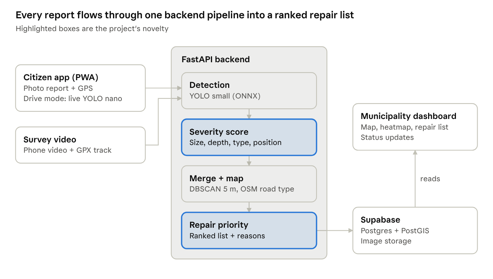
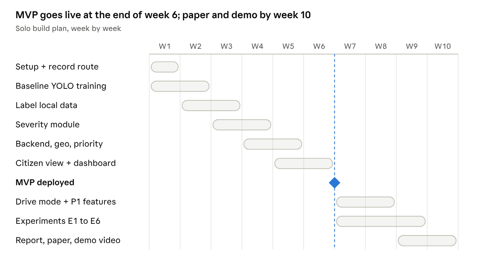

# PRD: RoadSense — Smart Pothole & Road Damage Detection with Severity Mapping

Nov 26, 2026 · @Ninad Pandith M N

## Overview

RoadSense detects road damage from phone or dashcam video, scores how dangerous each defect is, and gives a city a ranked repair list on a live map. It is a solo, final-year B.Tech project built with AI-assisted (vibe) coding. The goal is a deployed, public demo within 10 weeks that stands out on a resume.

| Item         | Decision                                                                      |
|--------------|-------------------------------------------------------------------------------|
| Builder      | 1 person (solo), AI-assisted coding                                           |
| Target       | Working MVP in 6 weeks, polished + paper draft in 10 weeks                    |
| Product      | One web app (installable PWA) with two views: Citizen and Municipality        |
| Pilot area   | A 10–15 km route you ride daily in your own city (home or college)            |
| Core novelty | Severity score (size + depth + type + position) and a repair-priority ranking |
| Deliverables | Live URL, GitHub repo, demo video, project report, conference paper draft     |

## Problem statement

Cities fix potholes by complaint, not by danger, so the most dangerous damage often waits longest.

- **Safety:** potholes cause serious crashes in India every year, hitting two-wheeler riders hardest, especially in the monsoon. (Cite the latest figure from the MoRTH *Road Accidents in India* report in the final report.)

- **No reliable data:** complaints are scattered across apps, calls and social media. They are duplicated and often have no exact location.

- **No prioritisation:** engineers have a limited budget and no objective way to decide which defect to fix first.

- **Gap in existing work:** most research detects and classifies damage. Few systems measure how severe each defect is, and fewer turn that into a repair priority a city can act on.

**Problem statement (for the report):** *Design a low-cost system that detects road damage from ordinary phone video and citizen photos, estimates the severity of each defect, removes duplicate reports, and ranks repairs by risk to road users.*

## Goals, non-goals and success metrics

The project succeeds when a stranger can open the live link, upload a road photo, and see it scored and ranked on the map within seconds.

**Goals**

1.  Detect 4 damage types (pothole, alligator, transverse and longitudinal cracks) from photos and video.

2.  Score every defect Minor / Moderate / Dangerous, and show the score is close to human judgement.

3.  Merge duplicate detections and reports of the same defect into one map point.

4.  Rank all defects into a repair list the city can filter by area.

5.  Ship a public, deployed web app and an open GitHub repo.

**Non-goals (v1)**

- Real integration with a municipal system or government portal

- Exact pothole depth in centimetres (relative depth is enough)

- Native Android/iOS apps

- User accounts beyond a simple admin login

**Success metrics**

| Metric                                              | Target                               |
|-----------------------------------------------------|--------------------------------------|
| Pothole detection mAP@0.5 (test set)                | ≥ 0.60                               |
| Overall mAP@0.5, 4 classes                          | ≥ 0.50                               |
| Gain from adding local data (local test set)        | +10 points mAP or more               |
| Severity agreement with hand labels                 | ≥ 75% accuracy, weighted kappa ≥ 0.6 |
| Duplicate merge accuracy (same pothole → one point) | ≥ 90%                                |
| Photo report: upload to result on map               | \< 5 s                               |
| Video processing on a laptop GPU                    | ≥ 15 FPS                             |
| Live in-browser detection on a mid-range phone      | ≥ 5 FPS                              |

Targets are starting points. Record the real numbers honestly; a clear comparison matters more than hitting every target.

## Users and personas

The product serves two real users; the examiner and recruiter are the audience for the demo.

| Persona              | Who                                                            | Needs                                                             | Uses                            |
|----------------------|----------------------------------------------------------------|-------------------------------------------------------------------|---------------------------------|
| Municipal engineer   | Ward or road department engineer with a fixed repair budget    | See where damage is, how bad it is, and what to fix first         | Municipality dashboard          |
| Citizen              | Daily commuter, often on a two-wheeler                         | Report a pothole in under 30 seconds and see that it was acted on | Citizen view (phone)            |
| Survey rider         | Volunteer, delivery rider or bus with a phone on the dashboard | Record a route once and have every defect logged automatically    | Drive mode / video upload       |
| Examiner / recruiter | Viva panel, interviewer                                        | Understand the novelty and see it working live                    | Live demo, README, results page |

## Key user stories

**Citizen**

1.  As a citizen, I open the link on my phone, take a photo of a pothole, and my GPS location is added automatically.

2.  I see the AI result immediately: damage type, severity, and whether it was merged with an existing report.

3.  I get a tracking ID and can see the status change: Reported → Verified → Assigned → Fixed.

4.  If my photo is not road damage, the app tells me and does not submit it.

**Survey rider**

1.  As a rider, I mount my phone, start Drive mode, and the app detects damage live and logs each one with GPS.

2.  Or I upload a recorded video plus its GPS track, and the server processes it into map points.

**Municipal engineer**

1.  As an engineer, I open the dashboard and see a city map with severity-coloured markers and a heatmap.

2.  I see a ranked repair list, filter it by ward or road type, and export it as CSV/PDF.

3.  I open a defect and see its photos, severity breakdown, report count and history.

4.  I change a defect's status, and the citizen who reported it sees the update.

5.  I see summary charts: open defects by severity, by ward, and fixed per week.

## Functional requirements

P0 = must have for the MVP (week 6). P1 = makes it a top project (week 10). P2 = only if time is left.

| ID  | Module    | Requirement                                                                     | Priority |
|-----|-----------|---------------------------------------------------------------------------------|----------|
| D1  | Detection | Detect 4 classes (D00, D10, D20, D40) in an image with box + confidence         | P0       |
| D2  | Detection | Process an uploaded video, sampling 3–5 frames per second                       | P0       |
| D3  | Detection | Reject non-road photos (no detection above threshold, or a road/not-road check) | P0       |
| D4  | Detection | Run live in the phone browser (ONNX Runtime Web) in Drive mode                  | P1       |
| S1  | Severity  | Compute a 0–1 severity score and label for every detection                      | P0       |
| S2  | Severity  | Relative depth from a monocular depth model inside the box                      | P1       |
| S3  | Severity  | Show the score breakdown (size, depth, type, position) in the UI                | P1       |
| G1  | GPS       | Attach GPS to photo reports (browser location or photo EXIF)                    | P0       |
| G2  | GPS       | Match video frames to a GPS track (GPX) by timestamp                            | P1       |
| G3  | GPS       | Merge detections within 5 m (DBSCAN, haversine) into one defect                 | P0       |
| G4  | GPS       | Snap each defect to its road and look up road type from OpenStreetMap           | P1       |
| R1  | Priority  | Compute a priority score and a ranked repair list                               | P0       |
| R2  | Priority  | Boost defects within 200 m of schools and hospitals (OSM)                       | P1       |
| R3  | Priority  | Estimate repair cost per defect from size and a per-m² rate                     | P2       |
| M1  | Dashboard | Map with severity-coloured markers + heatmap layer                              | P0       |
| M2  | Dashboard | Ranked repair table, filter by ward / road type / severity / status             | P0       |
| M3  | Dashboard | Defect detail page: photos, breakdown, report count, history                    | P0       |
| M4  | Dashboard | Change status; export repair list as CSV and PDF                                | P1       |
| M5  | Dashboard | Charts: open by severity, by ward, fixed per week                               | P1       |
| M6  | Dashboard | Public results page with model metrics and sample outputs                       | P1       |
| C1  | Citizen   | Photo report with camera, auto GPS, instant AI result                           | P0       |
| C2  | Citizen   | Tracking ID and status page for each report                                     | P0       |
| C3  | Citizen   | Installable PWA, works on any phone                                             | P1       |
| C4  | Citizen   | Hindi + English interface                                                       | P2       |
| A1  | Admin     | Simple admin login for the municipality view                                    | P0       |
| A2  | Admin     | Rate-limit reports to block spam                                                | P1       |

## Severity and priority algorithms

Severity says how dangerous one defect is; priority says which defect to fix first across the city. Both are simple weighted formulas, so they are easy to explain in a viva, and the weights are tuned on hand-labelled data.

### Severity score (per defect, 0–1)

```text
S = 0.35·A + 0.35·D + 0.20·T + 0.10·P
```

| Factor      | Meaning                              | How to compute (normalised 0–1)                                                                                     |
|-------------|--------------------------------------|---------------------------------------------------------------------------------------------------------------------|
| A, size     | How big the damage is                | Box area ÷ road area in the frame (road area from a fixed lower-frame region in v1, a road segmentation mask in v2) |
| D, depth    | How deep it looks                    | Depth Anything / MiDaS relative depth: mean depth inside the box minus the road around it, scaled per image         |
| T, type     | How dangerous this kind of damage is | Pothole 1.0, alligator crack 0.7, transverse 0.5, longitudinal 0.4                                                  |
| P, position | Is it in the wheel path              | 1.0 near lane centre, falling to 0.3 at the edge, from the box centre's x position                                  |

Labels: **Minor** S \< 0.40, **Moderate** 0.40–0.70, **Dangerous** ≥ 0.70. When a defect has several detections or reports, use the highest S.

**Validation:** hand-label 200 defects as Minor / Moderate / Dangerous before looking at scores. Report accuracy, a confusion matrix and weighted kappa. Then tune the weights with a small grid search or logistic regression on half the data and test on the other half. Report both the hand-picked and the tuned weights.

### Repair priority (per defect)

```text
Priority = S × R × (1 + 0.1·min(n, 10)) × (1 + 0.02·min(t, 30)) × B
```

| Term | Meaning                            | Values                                                          |
|------|------------------------------------|-----------------------------------------------------------------|
| S    | Severity score                     | 0–1                                                             |
| R    | Road importance from OSM road type | Trunk/primary 1.0, secondary 0.8, tertiary 0.6, residential 0.4 |
| n    | Number of independent reports      | Capped at 10 (max ×2 boost)                                     |
| t    | Days since first reported          | Capped at 30 (max ×1.6 boost)                                   |
| B    | Sensitive-place boost              | 1.3 if within 200 m of a school or hospital, else 1.0           |

The dashboard sorts open defects by Priority and shows each term, so an engineer can see why a defect ranks high. Explaining the ranking is part of the novelty.

### Duplicate merging

Run DBSCAN on defect coordinates with the haversine metric, eps = 5 m, min_samples = 1. Each cluster becomes one defect. Keep all its photos, the report count n, and the highest severity. New reports join an existing cluster if they fall within 5 m of it.

## Non-functional requirements

The whole system must run on free tiers and a free Colab/Kaggle GPU.

| Area            | Requirement                                                                                  |
|-----------------|----------------------------------------------------------------------------------------------|
| Performance     | Photo report result \< 5 s; dashboard map loads \< 2 s with 1,000 defects                    |
| Model size      | Deployed detector ≤ 25 MB (YOLO nano/small, exported to ONNX)                                |
| Accuracy        | Meet the metric targets above on a held-out test set never used for tuning                   |
| Privacy         | Blur faces and number plates in stored images before saving; store no phone numbers or names |
| Security        | Admin routes behind login; uploads limited to images/videos ≤ 50 MB; rate limit per IP       |
| Cost            | ₹0 running cost: free hosting, free database tier, free GPU for training                     |
| Reliability     | Model and API versioned; every result stores the model version used                          |
| Usability       | Citizen report possible in 3 taps; works on a 5-year-old Android phone                       |
| Reproducibility | One-command local setup (Docker Compose); training notebook reruns end to end                |

## System architecture and tech stack

One React web app talks to one FastAPI backend that runs the models and stores everything in Postgres with PostGIS. This is the decided stack: popular, free to host, and well known to AI coding tools, so vibe coding works smoothly.



RoadSense architecture · 2 inputs, 4-step pipeline, 1 dashboard

Photos and videos enter one pipeline; severity and priority, the two highlighted steps, are what make this more than a detector.

| Layer            | Choice                                                                              | Why                                                                                                  |
|------------------|-------------------------------------------------------------------------------------|------------------------------------------------------------------------------------------------------|
| Frontend         | React + Vite + TypeScript + Tailwind, Leaflet maps, installable PWA                 | One app for Citizen and Municipality views; a real web app looks stronger on a resume than Streamlit |
| In-browser AI    | ONNX Runtime Web running YOLO nano                                                  | Live Drive-mode detection on the phone with no server cost                                           |
| Backend          | Python FastAPI                                                                      | Same language as the ML code; auto API docs at /docs                                                 |
| Detection        | Ultralytics YOLO (YOLO11 or the latest version), small for server, nano for browser | Fast, accurate, easy to train and export                                                             |
| Depth            | Depth Anything V2 (small)                                                           | Relative depth from a single photo                                                                   |
| Clustering / geo | scikit-learn DBSCAN, OSMnx / Overpass API for roads, schools, hospitals             | Free OpenStreetMap data                                                                              |
| Database + files | Supabase (Postgres + PostGIS + Storage)                                             | Free tier, spatial queries, image storage, built-in auth                                             |
| Training         | Kaggle or Google Colab free GPU                                                     | No hardware needed                                                                                   |
| Hosting          | Vercel (frontend), Azure Container Apps via Azure for Students credit (backend)     | Free, public URLs for the resume                                                                     |
| Tooling          | GitHub, GitHub Actions (tests), Docker Compose                                      | Shows engineering practice                                                                           |

## Data

Train on the public RDD2022 dataset, then fine-tune on about 500 labelled frames from your own city; that local set is a contribution you can publish.

### Sources

| Dataset                     | What it gives                                                                                                               | Use                                                          |
|-----------------------------|-----------------------------------------------------------------------------------------------------------------------------|--------------------------------------------------------------|
| RDD2022                     | About 47,000 road images from India, Japan, Czech Republic, Norway, United States and China, labelled with 4 damage classes | Base training; report results on the India subset separately |
| Local RoadSense set (yours) | 400–600 labelled frames from your pilot route, phone video at 1080p                                                         | Fine-tuning + a local test set                               |
| Severity set (yours)        | 200 defects hand-labelled Minor / Moderate / Dangerous                                                                      | Validating and tuning the severity formula                   |
| OpenStreetMap               | Road types, schools, hospitals, ward boundaries where available                                                             | Priority score and map filters                               |

### Collecting local data

- Mount the phone on a bike or car dashboard, camera facing the road, and record in daylight. Also record one rainy or evening run for robustness.

- Run a GPS logger app at the same time (exports GPX), or use a camera app that stores GPS.

- Cover 10–15 km with a mix of main roads and residential lanes. Ride slowly over damaged stretches.

- Extract 1 frame per second, remove near-duplicates and blurry frames, then pick the 400–600 most useful.

- Split by **route segment**, not by frame (train 70%, validation 15%, test 15%), so similar frames never leak into the test set.

### Labelling

- Use Roboflow: upload frames, let the RDD2022-trained model pre-label, then correct each box by hand.

- Use the same 4 classes and the same rules as RDD2022.

- Label severity for 200 potholes separately, without looking at the model's score.

### Data model

| Table          | Key fields                                                                                                                      |
|----------------|---------------------------------------------------------------------------------------------------------------------------------|
| reports        | id, source (citizen / video / drive), image_url, lat, lon, created_at, tracking_code                                            |
| detections     | id, report_id, class, confidence, box, severity_score, size, depth, type_weight, position, model_version                        |
| defects        | id, location (PostGIS point), worst_severity, report_count, road_type, near_sensitive, priority, status, first_seen, updated_at |
| status_history | id, defect_id, old_status, new_status, changed_by, changed_at                                                                   |

## Evaluation and experiments

Six experiments give the report and paper their results section; each one answers a question an examiner will ask.

| \#  | Question                      | Experiment                                                                               | Metrics                                                            |
|-----|-------------------------------|------------------------------------------------------------------------------------------|--------------------------------------------------------------------|
| E1  | Which model is best?          | YOLO nano vs small vs medium (and one older version, e.g. YOLOv8s) on RDD2022 India test | mAP@0.5, mAP@0.5:0.95, per-class precision/recall, FPS, model size |
| E2  | Does local data help?         | RDD2022-only vs RDD2022 + local, both tested on the local test set                       | mAP@0.5 gain, confusion matrix                                     |
| E3  | Does the severity score work? | Formula vs 200 hand labels; hand-picked vs tuned weights                                 | Accuracy, weighted kappa, confusion matrix                         |
| E4  | Does depth matter?            | Ablation: severity with and without D (and without each factor)                          | Change in kappa                                                    |
| E5  | Does merging work?            | Ride the same route twice; count unique potholes before and after DBSCAN                 | Merge accuracy, duplicates left                                    |
| E6  | Is it fast enough?            | Photo report latency; video FPS on GPU and CPU; browser FPS on 2 phones                  | Seconds, FPS                                                       |

Also show 10–15 sample images with boxes and severity labels, including failure cases (shadows, water-filled potholes, speed breakers mistaken for damage). Honest failure analysis impresses examiners.

## Vibe coding build plan

Build one module at a time with an AI coding tool, test it, commit it, then move on; never ask for the whole app in one prompt.

**Tools:** Claude Code or Cursor for the code, Kaggle/Colab for training, Roboflow for labelling, GitHub for every working step.

**Rules**

- Put this PRD in the repo as docs/PRD.md and tell the AI to follow it in every session.

- Keep a CLAUDE.md / project rules file with the stack, folder layout and coding style.

- One feature per session. Ask for tests with every module (pytest for backend, a small test image set for models).

- When something breaks, paste the full error and the file, not a summary.

- Commit after every working step, so you can roll back.

- After each module, ask: *"Explain this code line by line for my viva and list 5 questions an examiner may ask."* Write the answers in docs/viva-notes.md.

**Build order and starter prompts**

1.  **Repo setup:** "Create a monorepo with /ml (training + inference), /backend (FastAPI), /frontend (React + Vite + TS + Tailwind PWA), /docs. Add Docker Compose, a README, and GitHub Actions running pytest."

2.  **Training notebook:** "Write a Kaggle notebook that prepares RDD2022 (India subset first, then all) in YOLO format with classes D00, D10, D20, D40, trains YOLO small for 100 epochs, saves metrics and plots, and exports ONNX for small and nano models."

3.  **Inference module:** "Write ml/detect.py with a function that takes an image and returns boxes, classes and confidences using the ONNX model, plus a video function that samples 4 frames per second."

4.  **Severity module:** "Write ml/severity.py implementing S = 0.35A + 0.35D + 0.20T + 0.10P exactly as in docs/PRD.md, using Depth Anything V2 small for D, with unit tests."

5.  **Geo module:** "Write backend/geo.py: DBSCAN merge with haversine, eps 5 m; OSM road type lookup; school/hospital proximity; priority formula from the PRD."

6.  **Backend API:** "Create FastAPI endpoints: POST /reports (image + lat/lon), POST /videos (video + GPX), GET /defects (filters), GET /defects/{id}, PATCH /defects/{id}/status, GET /repair-list (CSV), GET /track/{code}. Use Supabase Postgres + PostGIS and Supabase Storage."

7.  **Citizen view:** "Build a mobile-first React page: camera capture, auto GPS, upload, show result card with type, severity and tracking code; make it an installable PWA."

8.  **Dashboard:** "Build the municipality dashboard: Leaflet map with severity markers and heatmap, ranked repair table with filters, defect detail page, status change, charts."

9.  **Drive mode:** "Add a Drive mode page that runs the YOLO nano ONNX model in the browser with onnxruntime-web on the camera stream, draws boxes, and uploads each detection with GPS."

10. **Deploy:** "Write a Dockerfile and GitHub Actions deploy to Azure Container Apps (backend) and Vercel config (frontend); add environment variable docs."

## Timeline

You build alone, so the plan is sequential with small overlaps: a deployed MVP at the end of week 6, then 4 weeks to add P1 features, run experiments and write up.



10-week solo plan · MVP at week 6

Weeks 1–6 cover every P0 requirement; weeks 7–10 are where the project goes from good to best. Record your local route in week 1 so labelling is never the bottleneck.

**Weekly checkpoints**

- [ ] W1: repo + Supabase set up, pilot route recorded, RDD2022 downloaded

- [ ] W2: baseline model trained, first mAP numbers saved

- [ ] W3: 500 local frames labelled, model fine-tuned

- [ ] W4: severity module with tests; 200 severity hand labels done

- [ ] W5: API, merging and priority working end to end

- [ ] W6: citizen view + dashboard deployed at a public URL

- [ ] W8: Drive mode and P1 dashboard features live

- [ ] W9: all experiments done, results page live

- [ ] W10: report, paper draft, demo video, LinkedIn post

## Risks and mitigations

The biggest risk for a solo builder is scope; P0 is kept small enough to finish in 6 weeks no matter what.

| Risk                           | Impact                 | Mitigation                                                                                  |
|--------------------------------|------------------------|---------------------------------------------------------------------------------------------|
| Scope too big for one person   | Unfinished project     | Ship P0 first; P1 only after a deployed MVP; P2 is optional                                 |
| Low accuracy on cracks         | Weak results           | Report per class; potholes are the focus; more local labels for weak classes                |
| Depth estimate is noisy        | Severity less reliable | Use relative depth only; ablation E4 shows its real value; fall back to size + type         |
| GPS error 5–15 m on phones     | Wrong merges           | Average GPS over 3 s; eps tuned in E5; show confidence radius                               |
| Free GPU time runs out         | Training delays        | Train small model first; save checkpoints to Drive/Kaggle output; use Kaggle's weekly quota |
| Free hosting is slow or sleeps | Bad live demo          | Warm up before the viva; record a backup demo video                                         |
| Code you can't explain         | Lost viva marks        | Viva notes after every module; rewrite unclear parts in your own way                        |
| Privacy of people in photos    | Ethics question        | Blur faces and plates before storing; mention it in the report                              |

## Deliverables and what makes it a best project

A panel or recruiter should be able to click one link, try it, and see real numbers; that is what separates this from a typical final-year project.

**Deliverables**

- [ ] Live web app URL (citizen view + dashboard with demo login)

- [ ] Public GitHub repo: clean README, architecture image, setup steps, demo GIF

- [ ] Trained models and training notebook (published on Hugging Face)

- [ ] Local RoadSense dataset (published, faces and plates blurred)

- [ ] Results page: all experiment tables and sample outputs

- [ ] 3-minute demo video

- [ ] Project report and viva presentation

- [ ] Conference paper draft (IEEE format)

- [ ] LinkedIn post with the demo video

**What makes it stand out**

- **Beyond detection:** severity + priority, explained per defect, not just boxes on images.

- **Real local data:** your own city's roads and a published dataset.

- **Edge AI:** live detection inside the phone browser.

- **Full-stack and deployed:** a real product people can use, not a notebook.

- **Evidence:** model comparison, ablation and failure analysis.

**Future scope**

- Cameras on city buses or garbage trucks for automatic daily surveys

- Predicting where potholes will form before the monsoon, from history and rainfall

- Integration with municipal complaint portals

- Exact depth with stereo cameras or LiDAR phones

**Open questions**

- Which city and pilot route will you use? Pick it in week 1.

- Is there a target conference for the paper? Check your department's list of IEEE/Springer conferences in your area.

- Can a local ward office review the dashboard? Even one comment from a real engineer is strong evidence.
