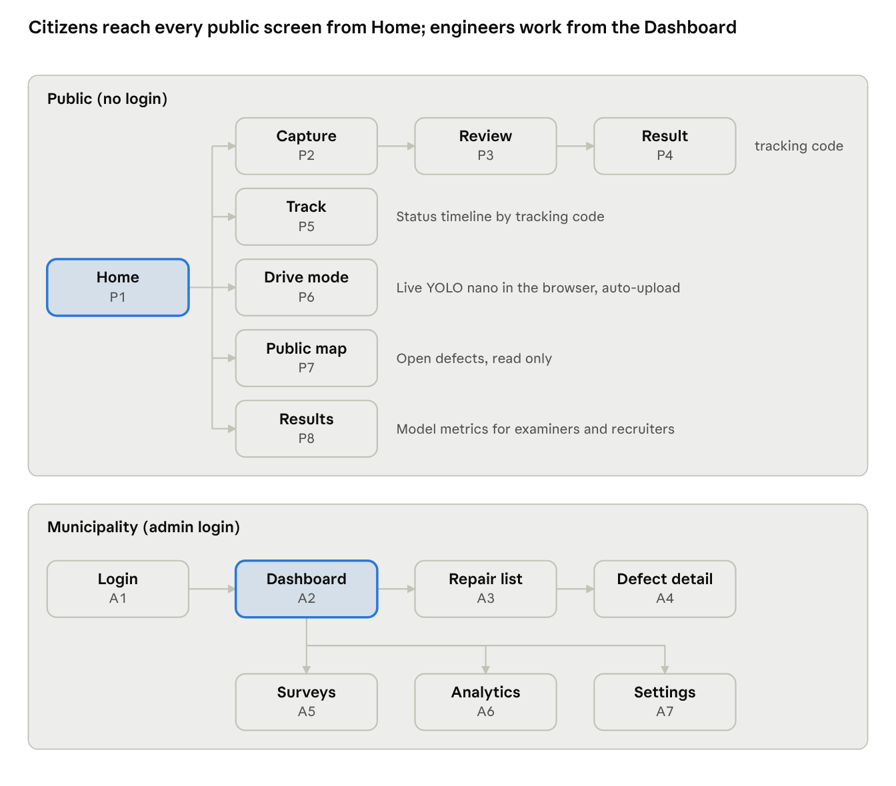
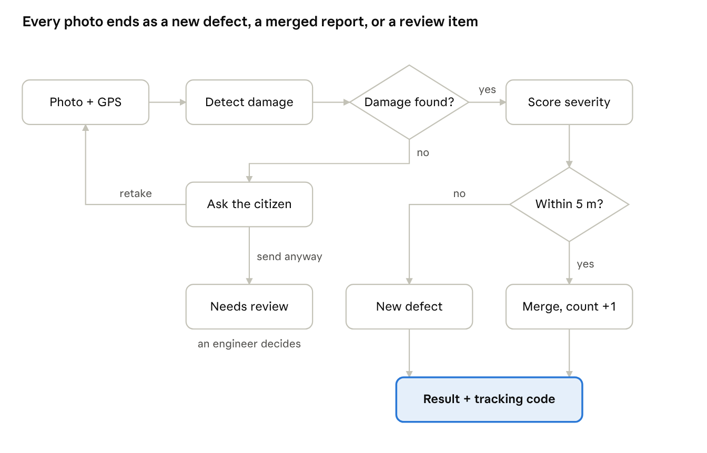
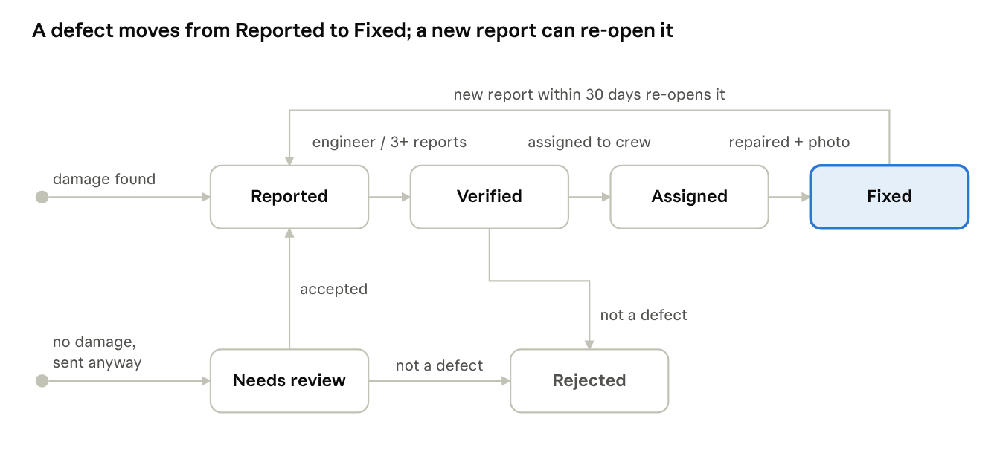

# RoadSense: App Flow

Nov 26, 2026 · @Ninad Pandith M N

This document turns Doc into screens and step-by-step user flows, ready to hand to an AI coding tool.

## App map

One web app, two areas: everything a citizen needs is one tap from Home, and everything an engineer needs starts from the Dashboard.

App map · 8 public screens, 7 admin screens

IDs (P1–P8, A1–A7) match the Screen inventory below. A bottom tab bar on phones links Home, Track and Map; the admin area has a left sidebar for A2–A7.

## Screen inventory

The app has 15 screens in one React PWA: 8 public screens for citizens and visitors, 7 behind the admin login for the municipality.

| \#  | Screen        | Route                   | User                | Purpose                                                          | PRD IDs        |
|-----|---------------|-------------------------|---------------------|------------------------------------------------------------------|----------------|
| P1  | Home          | /                       | Everyone            | Three big actions: Report, Track, Drive mode; link to public map | C3             |
| P2  | Capture       | /report                 | Citizen             | Open camera or pick a photo; get GPS                             | C1, G1         |
| P3  | Review        | /report/review          | Citizen             | Preview photo, confirm pin on map, optional note, submit         | C1, G1         |
| P4  | Result        | /report/result/:code    | Citizen             | AI result: type, severity, merged or new, tracking code          | C1, S1, S3, D3 |
| P5  | Track         | /track and /track/:code | Citizen             | Enter code, see status timeline and photo                        | C2             |
| P6  | Drive mode    | /drive                  | Survey rider        | Live camera with boxes, GPS, detection counter, auto-upload      | D4, G1         |
| P7  | Public map    | /map                    | Everyone            | Read-only map of open defects by severity                        | M1             |
| P8  | Results       | /results                | Examiner, recruiter | Model metrics, experiment tables, sample outputs                 | M6             |
| A1  | Login         | /admin/login            | Engineer            | Email + password (Supabase Auth)                                 | A1             |
| A2  | Dashboard     | /admin                  | Engineer            | KPI cards, map with markers + heatmap, top 10 priorities         | M1, R1         |
| A3  | Repair list   | /admin/repairs          | Engineer            | Ranked table, filters, bulk status change, CSV/PDF export        | M2, M4, R1     |
| A4  | Defect detail | /admin/defects/:id      | Engineer            | Photos, severity breakdown, priority terms, history, status      | M3, M4, S3     |
| A5  | Surveys       | /admin/surveys          | Engineer / surveyor | Upload video + GPX, see job progress                             | D2, G2         |
| A6  | Analytics     | /admin/analytics        | Engineer            | Charts: open by severity, by ward, fixed per week                | M5             |
| A7  | Settings      | /admin/settings         | Engineer            | Severity/priority weights, thresholds, merge radius              | S1, R1, G3     |

## Flow 1: Citizen photo report

A citizen goes from opening the app to a scored, mapped report in 3 taps and under 30 seconds, with no account.

Citizen photo report · 2 decisions, 3 outcomes

**Screen by screen**

1.  **Home (P1):** taps *Report a pothole*.

2.  **Capture (P2):** the browser asks for camera and location permission once. The citizen takes a photo or picks one from the gallery. The app reads GPS from the browser, or from the photo's EXIF if picked from the gallery.

3.  **Review (P3):** shows the photo, a small map with the pin, and an optional note (max 200 characters). The citizen can drag the pin if GPS is off. Taps *Submit*.

4.  **Uploading:** progress bar; the image is resized to max 1280 px on the phone before upload to save data.

5.  **Server check:** the backend runs detection (see Backend processing sequence).

    - **No damage found:** the Result screen says *"We couldn't find road damage in this photo"* with *Retake* and *Submit anyway* buttons. *Submit anyway* saves it as *Needs review* for an engineer.

    - **Damage found:** severity is scored and the report is merged with an existing defect within 5 m, or creates a new one.

6.  **Result (P4):** a card shows the damage type, severity badge (Minor / Moderate / Dangerous), the score breakdown bars, and either *"New defect added"* or *"Added to an existing report (now 4 reports)"*. The tracking code (for example RS-7K2Q) is shown large with *Copy* and *Share* buttons, and saved in the phone's local storage.

7.  The citizen taps *Done* (back to Home) or *Track this report* (P5).

## Flow 2: Tracking a report

Citizens track reports with the code alone; reports from this phone are listed automatically.

1.  **Track (P5)** opens from Home or from the Result screen.

2.  If this phone has made reports, *My reports* lists them (from local storage) with their current status. Otherwise the citizen types or pastes a code.

3.  **Status page** (/track/RS-7K2Q) shows:

    - the photo, damage type and severity badge

    - a status timeline: Reported → Verified → Assigned → Fixed, with a date on each step reached

    - how many people reported the same defect

    - after *Fixed*: the engineer's after-repair photo, if uploaded

4.  **Wrong code:** *"No report found with this code"*, with a retry field.

5.  **Share:** the status page link can be shared on WhatsApp; it shows the photo and status but no personal data.

## Flow 3: Drive mode

Drive mode turns a phone on a dashboard into a road surveyor: it detects damage live in the browser and uploads only the frames with damage.

1.  **Home (P1):** taps *Drive mode*. A one-time safety screen: *"Mount the phone before riding. Do not touch it while moving."* with *I understand*.

2.  **Setup:** the app downloads the YOLO nano ONNX model (about 6–12 MB, cached after the first time), asks for camera + location, and shows a framing guide: *"Point the camera at the road, about 5–10 m ahead."*

3.  **Start:** one large *Start* button. The screen stays awake (Wake Lock API).

4.  **While riding:**

    - the model runs on about 5 frames per second; boxes are drawn on the live view in severity colours

    - a counter shows *Detections: 12 · Uploaded: 9 · Distance: 4.2 km*

    - a detection above 0.5 confidence saves that frame + GPS + time to a local queue

    - the same defect seen in consecutive frames is saved once (keep the frame with the highest confidence within 2 seconds)

    - the queue uploads in the background; with no network it waits and retries

5.  **Stop:** a summary screen with the number of detections, distance, and a mini map of the route with the points. *Upload remaining* if anything is still queued.

6.  On the server, each uploaded frame goes through the same processing as a photo report, including full severity with depth.

## Flow 4: Survey video upload

Long recorded videos are processed as a background job, so the engineer uploads and leaves.

1.  **Surveys (A5):** taps *New survey*, picks a video (max 50 MB per file; split longer rides) and its GPX track, and names the route.

2.  The app checks that the video and GPX times overlap. If they don't, it warns: *"GPS track doesn't cover this video's time; points will be unplaced."*

3.  Upload with a progress bar. A job card appears in the list.

4.  **Job states:** Queued → Extracting frames → Detecting (shows % done) → Scoring → Merging → Done, or Failed with the reason.

5.  **Done:** the card shows *"38 detections → 21 defects (9 new, 12 merged)"* with *View on map*, which opens the Dashboard filtered to this survey.

## Flow 5: Municipality dashboard and repair list

An engineer logs in, sees the worst defects first, and assigns repairs in a few clicks.

**Login (A1)**

1.  Email + password via Supabase Auth. Wrong password: inline error; 5 failures lock the account for 10 minutes.

2.  For the demo, a *Try demo account* button logs in to a read-only demo user, so examiners and recruiters can explore without credentials.

**Dashboard (A2)**

1.  Top row of KPI cards: *Open defects*, *Dangerous open*, *New this week*, *Fixed this week*.

2.  Map (Leaflet): markers coloured green / amber / red by severity, a heatmap toggle, and clustering when zoomed out. Clicking a marker opens a popup with photo, severity and *Open details*.

3.  Side panel: *Top 10 to fix*, ranked by priority, each with a one-line reason (for example *"Dangerous · main road · near school · 6 reports"*).

4.  A banner shows *Needs review (3)* for photos the AI rejected but citizens submitted anyway.

**Repair list (A3)**

1.  Ranked table: rank, photo thumbnail, type, severity, priority, road, ward, reports, age in days, status.

2.  Filters: ward, road type, severity, status, survey, date range. Sort by any column; default is priority.

3.  Select rows → *Mark Assigned* or *Mark Fixed* in bulk.

4.  *Export CSV* and *Export PDF* (the PDF is a work order: rank, location link, photo, severity).

5.  Clicking a row opens Defect detail (A4).

**Defect detail (A4)**

1.  Photo gallery from every report of this defect, newest first, with boxes drawn.

2.  Severity breakdown: four bars (size, depth, type, position) and the final score.

3.  Priority breakdown: each term of the formula with its value, so the ranking is explainable.

4.  Mini map with the 5 m merge circle and all report points.

5.  Status control and history (see Flow 6). *Not a defect* removes it from the list and saves it as a false positive for retraining.

**Analytics (A6)** shows open defects by severity, by ward, and fixed per week. **Settings (A7)** lets an admin adjust weights and thresholds; every change is logged and priorities are recalculated.

## Flow 6: Defect status lifecycle

Each defect has one status, changed by an engineer on the Defect detail screen; citizens see the same status on their tracking page.

Defect status lifecycle · 6 states

- **Verified** is set by an engineer, or automatically when 3 or more reports merge into one defect.

- **Fixed** asks for an optional after-repair photo; the tracking page shows it.

- **Rejected** can be chosen from any open state with *Not a defect*; the image is saved as a false positive for retraining.

- Every change is written to status_history with who changed it and when.

## Backend processing sequence

Every photo, Drive-mode frame and video frame goes through the same 9 steps in the FastAPI backend; a photo report finishes in under 5 seconds.

1.  **Receive** POST /reports with image, lat, lon, source (citizen / drive / survey) and optional note. Check file type and size and the rate limit (10 reports per IP per hour).

2.  **Store** the original image in Supabase Storage; save a reports row with status *Processing*.

3.  **Privacy:** detect and blur faces and number plates; replace the stored image with the blurred one.

4.  **Detect** with YOLO small (ONNX). Keep boxes with confidence ≥ 0.35. No boxes → mark the report *No damage found* and return.

5.  **Score** each box: size A, depth D (Depth Anything V2 small), type T, position P → severity S and label. Save to detections with the model version.

6.  **Merge:** find open defects within 5 m (PostGIS ST_DWithin). Found → attach, increase report_count, keep the highest severity. None → create a new defect.

7.  **Enrich** new defects: road type from OSM, ward, and whether a school or hospital is within 200 m. Cache OSM lookups by area.

8.  **Prioritise:** recalculate the priority for this defect with the PRD formula.

9.  **Respond** with type, severity, breakdown, merged or new, defect ID and tracking code. The dashboard updates live through Supabase Realtime.

A nightly job recalculates every open defect's priority, because the age term grows each day.

## Error, empty and edge states

Every screen has a defined message for when things go wrong; an AI coding tool should build these alongside the happy path, not after.

| Situation                       | Where      | What the user sees                                                                                      |
|---------------------------------|------------|---------------------------------------------------------------------------------------------------------|
| Camera permission denied        | P2, P6     | "Camera is blocked. Allow it in browser settings, or pick a photo from your gallery."                   |
| Location denied or no GPS fix   | P2, P3, P6 | Pin defaults to map centre; "Drag the pin to where the pothole is." Drive mode won't start without GPS. |
| GPS accuracy worse than 30 m    | P3         | Amber note: "Location is approximate. Please check the pin."                                            |
| Offline                         | P3, P6     | Report saved in an outbox and sent automatically when online; Drive mode keeps queueing                 |
| Photo too dark or blurry        | P4         | "Photo is too dark or blurry. Try again in better light."                                               |
| No damage detected              | P4         | Retake or Submit anyway (goes to Needs review)                                                          |
| Server slow (\> 10 s)           | P4         | "Still analysing…" then "We saved your report and will finish it shortly" with the tracking code        |
| Rate limit hit                  | P3         | "Too many reports from this network. Try again in an hour."                                             |
| Device too slow for live model  | P6         | Falls back to capturing 1 frame every 2 s and sending it to the server                                  |
| Location outside the pilot area | P3         | "RoadSense currently covers \[pilot area\] only." Report is not saved.                                  |
| No defects yet                  | A2, A3, P7 | Empty map with "No reports yet. Share the report link to get started."                                  |
| Survey job failed               | A5         | Red card with the reason and a *Retry* button                                                           |
| Session expired                 | A2–A7      | Redirect to login, then back to the same page                                                           |

## Decisions taken and open questions

These choices were made to keep the app simple for a solo build; each can be changed later without redesigning the flows.

**Decisions**

- Citizens never log in; a tracking code identifies each report, and no names or phone numbers are stored.

- One admin role in v1. Ward-level roles (engineer sees only their ward) are future scope.

- The public map shows open defects only, with blurred photos.

- Survey video upload is admin-only; Drive mode is open to anyone.

- *Verified* is set by an engineer, or automatically when 3 or more independent reports merge into one defect.

- Status updates appear on the tracking page; no SMS or email notifications in v1.

- English UI in v1; Hindi is P2.

**Open questions**

- [ ] Pilot area boundary: draw it once you pick your route (needed for the *outside pilot area* check).

- [ ] Should *Fixed* need an after-repair photo? Recommended for the demo, optional in practice.

- [ ] Re-open rule: if a new report lands on a *Fixed* defect within 30 days, re-open it or create a new one? Default: re-open and flag it.
