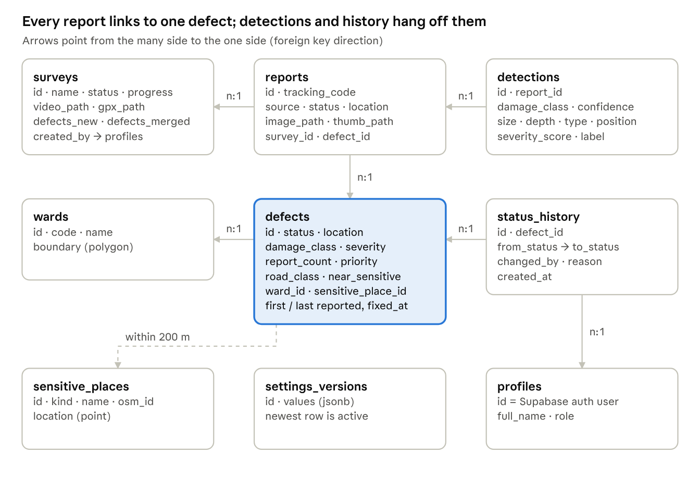

# RoadSense: Backend Schema

Nov 27, 2026 · @Ninad Pandith M N

The database tables, queries, security rules and API shapes behind RoadSense, in Supabase Postgres + PostGIS with a FastAPI backend. Requirements come from Doc; technology choices from Doc.

## Data model at a glance

defects is the centre of the model: many reports merge into one defect, and the dashboard, repair list and priority all read from it.



Entity-relationship diagram · 9 tables

sensitive_places is linked by a spatial query and an optional sensitive_place_id; settings_versions is read by the scoring and priority code. surveys.created_by and settings_versions.created_by also point to profiles (not drawn).

## Conventions

The same rules apply to every table so AI-generated migrations and models stay consistent.

| Topic        | Rule                                                                                                                                                 |
|--------------|------------------------------------------------------------------------------------------------------------------------------------------------------|
| Schema       | All app tables in public; Supabase's auth and storage schemas are not edited                                                                         |
| Names        | snake_case, plural table names (reports), singular column names, foreign keys \<table\>\_id                                                          |
| Primary keys | uuid with default gen_random_uuid(); bigint generated always as identity for log tables (status_history) and lookup tables (wards, sensitive_places) |
| Time         | timestamptz, stored in UTC, shown in IST by the frontend; every table has created_at default now(); mutable tables also updated_at set by a trigger  |
| Location     | geography(Point, 4326) for points, geography(MultiPolygon, 4326) for areas; distances are then in metres                                             |
| Scores       | real between 0 and 1 with check (x between 0 and 1)                                                                                                  |
| Enums        | Postgres enum types (next section); add values with migrations, never rename                                                                         |
| Deletes      | No hard deletes from the app; rejected defects keep status rejected                                                                                  |
| Money        | Not stored in v1 (repair cost estimate is P2)                                                                                                        |
| JSON         | jsonb only for snapshots that are never filtered on (priority terms, settings)                                                                       |

## Enums

Eight enum types cover every fixed list in the PRD and App Flow.

| Enum           | Values                                                                      | Used in                 |
|----------------|-----------------------------------------------------------------------------|-------------------------|
| report_source  | citizen, drive, survey                                                      | reports.source          |
| report_status  | processing, done, no_damage, needs_review, failed                           | reports.status          |
| damage_class   | pothole (D40), alligator_crack (D20), crack_across (D10), crack_along (D00) | detections, defects     |
| severity_label | minor, moderate, dangerous                                                  | detections, defects     |
| defect_status  | needs_review, reported, verified, assigned, fixed, rejected                 | defects, status_history |
| survey_status  | queued, extracting, detecting, scoring, merging, done, failed               | surveys                 |
| road_class     | major (trunk/primary), secondary, tertiary, residential, unknown            | defects                 |
| user_role      | engineer, demo                                                              | profiles                |

The model's class index maps to damage_class in one place in code: 0 → crack_along, 1 → crack_across, 2 → alligator_crack, 3 → pothole (RDD2022 order D00, D10, D20, D40).

## Tables

Nine tables: one citizen photo creates one reports row, its detections, and either a new defects row or an update to an existing one. The DDL below is the reference for the first Alembic migration.

| Table             | One row is                                               | Written by                            |
|-------------------|----------------------------------------------------------|---------------------------------------|
| reports           | One photo or captured frame, from any source             | API on upload; worker for surveys     |
| detections        | One box the AI found in a report                         | API / worker                          |
| defects           | One damaged spot after merging (the thing engineers fix) | API / worker; engineers change status |
| status_history    | One status change of a defect                            | API                                   |
| surveys           | One uploaded video + GPX job                             | API, then worker                      |
| profiles          | One engineer or demo user (linked to Supabase Auth)      | Seed / admin                          |
| wards             | One city ward boundary                                   | Seed from GeoJSON                     |
| sensitive_places  | One school or hospital from OpenStreetMap                | Seed script                           |
| settings_versions | One saved set of weights and thresholds                  | Settings screen (A7)                  |

```sql
-- Extensions
create extension if not exists postgis;
create extension if not exists pgcrypto;

-- 1. profiles: one row per engineer / demo user
create table profiles (
id uuid primary key references auth.users(id) on delete cascade,
full_name text not null,
role user_role not null default 'engineer',
created_at timestamptz not null default now()
);

-- 2. wards: city ward boundaries (seeded once)
create table wards (
id bigint generated always as identity primary key,
code text unique not null, -- e.g. 'W-112'
name text not null,
boundary geography(MultiPolygon, 4326) not null
);

-- 3. sensitive_places: schools and hospitals from OSM (seeded)
create table sensitive_places (
id bigint generated always as identity primary key,
kind text not null check (kind in ('school', 'hospital')),
name text,
osm_id bigint unique,
location geography(Point, 4326) not null
);

-- 4. surveys: uploaded video + GPX processing jobs
create table surveys (
id uuid primary key default gen_random_uuid(),
name text not null,
video_path text not null, -- storage: survey-uploads/
gpx_path text,
status survey_status not null default 'queued',
progress smallint not null default 0 check (progress between 0 and 100),
frames_total int,
detections_count int not null default 0,
defects_new int not null default 0,
defects_merged int not null default 0,
error text,
created_by uuid not null references profiles(id),
started_at timestamptz,
finished_at timestamptz,
created_at timestamptz not null default now(),
updated_at timestamptz not null default now()
);

-- 5. defects: one damaged spot after merging
create table defects (
id uuid primary key default gen_random_uuid(),
location geography(Point, 4326) not null,
damage_class damage_class, -- null only for needs_review without detection
severity_score real check (severity_score between 0 and 1),
severity_label severity_label,
report_count int not null default 1 check (report_count >= 1),
road_class road_class not null default 'unknown',
road_name text,
osm_way_id bigint,
ward_id bigint references wards(id),
near_sensitive boolean not null default false,
sensitive_place_id bigint references sensitive_places(id),
priority real not null default 0,
priority_terms jsonb not null default '{}', -- {"S":0.82,"R":1.0,"n":6,"t":12,"B":1.3}
status defect_status not null default 'reported',
first_reported_at timestamptz not null default now(),
last_reported_at timestamptz not null default now(),
verified_at timestamptz,
assigned_at timestamptz,
fixed_at timestamptz,
fixed_photo_path text,
reopened_count int not null default 0,
created_at timestamptz not null default now(),
updated_at timestamptz not null default now()
);

-- 6. reports: one photo / frame from any source
create table reports (
id uuid primary key default gen_random_uuid(),
tracking_code text unique not null check (tracking_code ~ '^RS-[2-9A-HJKMNP-Z]{4,6}\$'),
client_report_id uuid unique, -- idempotency key from the offline outbox
source report_source not null,
status report_status not null default 'processing',
survey_id uuid references surveys(id) on delete set null,
defect_id uuid references defects(id), -- set after merge; null if no_damage
image_path text, -- blurred, 1280 px, storage: report-images/
thumb_path text, -- 320 px
location geography(Point, 4326) not null,
gps_accuracy_m real,
captured_at timestamptz not null,
note text check (char_length(note) <= 200),
ip_hash text, -- sha256(ip + salt), for abuse checks only
model_version text,
error text,
created_at timestamptz not null default now(),
updated_at timestamptz not null default now()
);

-- 7. detections: boxes found in a report
create table detections (
id uuid primary key default gen_random_uuid(),
report_id uuid not null references reports(id) on delete cascade,
damage_class damage_class not null,
confidence real not null check (confidence between 0 and 1),
box real[4] not null, -- x1, y1, x2, y2 as fractions of width/height
size_score real not null check (size_score between 0 and 1),
depth_score real check (depth_score between 0 and 1), -- null if depth model skipped
type_score real not null check (type_score between 0 and 1),
position_score real not null check (position_score between 0 and 1),
severity_score real not null check (severity_score between 0 and 1),
severity_label severity_label not null,
model_version text not null,
created_at timestamptz not null default now()
);

-- 8. status_history: every status change
create table status_history (
id bigint generated always as identity primary key,
defect_id uuid not null references defects(id) on delete cascade,
from_status defect_status,
to_status defect_status not null,
changed_by uuid references profiles(id), -- null = system (auto-verify, re-open)
reason text,
created_at timestamptz not null default now()
);

-- 9. settings_versions: weights and thresholds; newest row is active
create table settings_versions (
id bigint generated always as identity primary key,
values jsonb not null,
created_by uuid references profiles(id),
created_at timestamptz not null default now()
);
```

Tracking codes use 4 characters from a 31-character alphabet without look-alikes (no 0/O, 1/I/L), about 923,000 codes; the API retries on a unique-key clash and moves to 5 characters if needed.

## Indexes and triggers

Spatial (GiST) indexes make the 5 m merge check and map queries fast; the rest support the screens' filters and sorts.

```sql
-- Spatial
create index defects_location_gix on defects using gist (location);
create index reports_location_gix on reports using gist (location);
create index sensitive_places_location_gix on sensitive_places using gist (location);
create index wards_boundary_gix on wards using gist (boundary);

-- Repair list (A3): open defects ranked by priority
create index defects_status_priority_idx on defects (status, priority desc);
create index defects_ward_idx on defects (ward_id);

-- Lookups
create index reports_defect_idx on reports (defect_id);
create index reports_survey_idx on reports (survey_id);
create index reports_iphash_time on reports (ip_hash, created_at desc);
create index detections_report_idx on detections (report_id);
create index status_history_defect on status_history (defect_id, created_at desc);
create index surveys_status_idx on surveys (status) where status not in ('done', 'failed');

-- updated_at trigger (attach to defects, reports, surveys)
create or replace function set_updated_at() returns trigger as \$\$
begin new.updated_at = now(); return new; end; \$\$ language plpgsql;

create trigger defects_updated_at before update on defects
for each row execute function set_updated_at();
```

## Core queries

Five queries do the real work; each runs inside one database transaction in FastAPI so two reports of the same pothole can't create two defects.

**1. Merge: find the defect this report belongs to** (radius from settings, default 5 m). Open defects match; a defect fixed in the last 30 days is matched and re-opened.

```sql
select id, status
from defects
where ST_DWithin(location, :point, :radius_m)
and (status in ('needs_review', 'reported', 'verified', 'assigned')
or (status = 'fixed' and fixed_at > now() - interval '30 days'))
order by ST_Distance(location, :point)
limit 1
for update;
```

- **Found:** report_count + 1, last_reported_at = now(), keep the higher severity, move location to the average of its reports. If it was fixed: set reported, reopened_count + 1, write a status_history row with reason "re-opened by new report".

- **Not found:** insert a new defect at the report's point, then run queries 3 and 4.

- **Auto-verify:** when report_count reaches 3 and status is reported, set verified with changed_by = null.

**2. Rate limit check** (10 reports per IP per hour):

```sql
select count(*) from reports
where ip_hash = :ip_hash and created_at > now() - interval '1 hour';
```

**3. Ward lookup** for a new defect:

select id from wards where ST_Covers(boundary, :point) limit 1;

**4. Nearest school or hospital within 200 m:**

```sql
select id from sensitive_places
where ST_DWithin(location, :point, 200)
order by ST_Distance(location, :point)
limit 1;
```

Road class and name come from the Overpass API (nearest way within 20 m), cached in memory by rounded coordinates; failures leave road_class = 'unknown' (R = 0.5).

**5. Priority** is computed in Python with the PRD formula, written to priority and the inputs to priority_terms, so the Defect detail screen can explain the rank. It runs after every merge and for all open defects in the nightly job.

```sql
update defects
set priority = :priority, priority_terms = :terms
where id = :id;
```

## Views, Row Level Security and realtime

The browser never writes to the database: citizens go through FastAPI, and engineers read directly but change data only through the API.

**Public view for the map (P7)** — open defects plus those fixed in the last 30 days, with no notes, IP hashes or report ids:

```sql
create view public_defects with (security_invoker = false) as
select d.id,
ST_Y(d.location::geometry) as lat,
ST_X(d.location::geometry) as lon,
d.damage_class, d.severity_label, d.status, d.report_count,
d.first_reported_at, d.fixed_at,
(select r.thumb_path from reports r
where r.defect_id = d.id and r.thumb_path is not null
order by r.created_at desc limit 1) as thumb_path
from defects d
where d.status in ('reported', 'verified', 'assigned')
or (d.status = 'fixed' and d.fixed_at > now() - interval '30 days');

grant select on public_defects to anon, authenticated;
```

**Row Level Security**

| Table                   | anon (citizens)           | authenticated (engineer, demo) | service role (FastAPI) |
|-------------------------|---------------------------|--------------------------------|------------------------|
| reports, detections     | none                      | select                         | all                    |
| defects                 | none (use public_defects) | select                         | all                    |
| status_history          | none                      | select                         | all                    |
| surveys                 | none                      | select                         | all                    |
| profiles                | none                      | select own row                 | all                    |
| wards, sensitive_places | select                    | select                         | all                    |
| settings_versions       | none                      | select                         | all                    |

```sql
alter table defects enable row level security;
create policy staff_read on defects for select to authenticated
using (exists (select 1 from profiles p where p.id = auth.uid()));
-- same policy pattern for reports, detections, status_history, surveys, settings_versions
```

The demo role is enforced in FastAPI: every write endpoint checks profiles.role = 'engineer' and returns 403 for demo users.

**Realtime:** add defects to the supabase_realtime publication. The dashboard subscribes to inserts and updates, and RLS limits events to signed-in staff. Tracking pages poll GET /track/{code} every 30 s instead.

## Storage buckets

Three Supabase Storage buckets; only blurred images are ever stored, which keeps both privacy and the 1 GB free limit safe.

| Bucket         | Public?                | Path pattern                                           | Contents                                                              | Limits                                 |
|----------------|------------------------|--------------------------------------------------------|-----------------------------------------------------------------------|----------------------------------------|
| report-images  | Public read            | {yyyy}/{mm}/{report_id}.jpg and {report_id}\_thumb.jpg | Blurred photo resized to 1280 px (JPEG quality 80) + 320 px thumbnail | Images only, ≤ 1 MB after resize       |
| fixed-photos   | Public read            | {defect_id}/{timestamp}.jpg                            | After-repair photo from the engineer                                  | ≤ 1 MB                                 |
| survey-uploads | Private (service role) | {survey_id}/video.mp4, {survey_id}/track.gpx           | Raw survey files                                                      | ≤ 50 MB; deleted when the job finishes |

**Rules**

- Blur faces and plates **in memory** before the first upload; the unblurred original is never written to storage.

- Strip all EXIF from stored images (GPS and time are already in the reports row).

- Frames from surveys and Drive mode are stored like citizen photos, but only frames with a detection.

## API schemas

Every endpoint has a Pydantic request and response model; errors share one shape so the frontend can show the Content Guidelines messages.

| Method + path                   | Auth                | Request                                                                                                | Response                                   | Screens     |
|---------------------------------|---------------------|--------------------------------------------------------------------------------------------------------|--------------------------------------------|-------------|
| POST /reports                   | none (rate-limited) | multipart: image, lat, lon, accuracy_m?, captured_at, source, note?, client_report_id                  | ReportResult                               | P3, P4, P6  |
| GET /track/{code}               | none (rate-limited) | —                                                                                                      | TrackResult                                | P5          |
| GET /defects                    | staff               | query: status, severity, ward_id, road_class, survey_id, from, to, bbox, sort, page, page_size (≤ 100) | Page\[DefectListItem\]                     | A2, A3      |
| GET /defects/{id}               | staff               | —                                                                                                      | DefectDetail                               | A4          |
| PATCH /defects/{id}/status      | engineer            | { "to_status", "reason?", "fixed_photo?" }                                                             | DefectDetail                               | A3, A4      |
| POST /defects/bulk-status       | engineer            | { "ids": \[...\], "to_status" } (≤ 100 ids)                                                            | { "updated": 12 }                          | A3          |
| GET /repair-list.csv            | staff               | same filters as /defects                                                                               | CSV file                                   | A3          |
| POST /surveys                   | engineer            | multipart: name, video, gpx                                                                            | Survey                                     | A5          |
| GET /surveys, GET /surveys/{id} | staff               | —                                                                                                      | Survey                                     | A5          |
| GET /stats                      | staff               | from, to                                                                                               | Stats                                      | A2, A6      |
| GET /settings, POST /settings   | staff / engineer    | SettingsValues                                                                                         | SettingsValues                             | A7          |
| POST /admin/recalculate         | CRON_SECRET header  | —                                                                                                      | { "updated": 214 }                         | nightly job |
| GET /health                     | none                | —                                                                                                      | { "status": "ok", "model_version": "..." } | monitoring  |

**ReportResult** (P4 result card)

```json
{
"tracking_code": "RS-7K2Q",
"status": "done",
"outcome": "merged",
"defect_id": "3f6c…",
"report_count": 4,
"damage_class": "pothole",
"confidence_label": "very_likely",
"severity": {
"label": "dangerous",
"score": 0.82,
"factors": { "size": 0.74, "depth": 0.88, "type": 1.0, "position": 0.9 },
"reason": "large, deep and in the wheel path"
},
"thumb_url": "https://…/report-images/2026/11/…_thumb.jpg"
}
```

outcome is one of new, merged, no_damage, needs_review, processing (slow server: the client then polls GET /track/{code}).

**DefectDetail** (A4)

```json
{
"id": "3f6c…", "status": "verified", "lat": 12.9716, "lon": 77.5946,
"damage_class": "pothole", "severity_label": "dangerous", "severity_score": 0.82,
"rank": 3, "priority": 2.71,
"priority_terms": { "S": 0.82, "R": 1.0, "n": 6, "t": 12, "B": 1.3 },
"priority_reason": "Dangerous · main road · near school · 6 reports · 12 days open",
"road_name": "MG Road", "ward": { "id": 12, "name": "Ward 112" },
"report_count": 6, "first_reported_at": "2026-11-15T04:12:00Z",
"reports": [ { "id": "…", "source": "citizen", "image_url": "…", "detections": [ … ], "created_at": "…" } ],
"history": [ { "from_status": "reported", "to_status": "verified", "changed_by": null, "reason": "3 reports", "created_at": "…" } ]
}
```

**Error shape** (all 4xx/5xx)

{ "error": { "code": "rate_limited", "message": "Too many reports from this network. Please try again in an hour.", "retry_after_s": 3600 } }

Error codes: invalid_image, image_too_dark, outside_pilot_area, rate_limited, not_found, forbidden_demo, invalid_transition, survey_gpx_mismatch, internal.

**Allowed status changes** (invalid_transition otherwise): needs_review → reported or rejected; reported → verified, assigned or rejected; verified → assigned or rejected; assigned → fixed or rejected; fixed → reported (system re-open only).

## Migrations, seed data and retention

Alembic owns the schema; seed scripts load the city data and defaults so a fresh database works end to end in one command.

**Migration order**

1.  0001_extensions_enums — PostGIS, pgcrypto, the 8 enums

2.  0002_core_tables — profiles, wards, sensitive_places, surveys, defects, reports, detections, status_history, settings_versions

3.  0003_indexes_triggers — indexes and updated_at triggers

4.  0004_views_rls — public_defects, RLS policies, grants, realtime publication

**Seed data** (backend/scripts/seed.py)

| Seed                 | Source                                                                   | Notes                                                                                                                                                                                                                                                                                                                                                                                                                                          |
|----------------------|--------------------------------------------------------------------------|------------------------------------------------------------------------------------------------------------------------------------------------------------------------------------------------------------------------------------------------------------------------------------------------------------------------------------------------------------------------------------------------------------------------------------------------|
| settings_versions v1 | PRD defaults                                                             | {"severity_weights": {"A":0.35,"D":0.35,"T":0.20,"P":0.10}, "thresholds": {"moderate":0.40,"dangerous":0.70}, "type_weights": {"pothole":1.0,"alligator_crack":0.7,"crack_across":0.5,"crack_along":0.4}, "road_weights": {"major":1.0,"secondary":0.8,"tertiary":0.6,"residential":0.4,"unknown":0.5}, "merge_radius_m":5, "min_confidence":0.35, "sensitive_radius_m":200, "sensitive_boost":1.3, "auto_verify_reports":3, "reopen_days":30} |
| wards                | City corporation open data or OSM admin boundaries (GeoJSON)             | Only wards that touch the pilot area                                                                                                                                                                                                                                                                                                                                                                                                           |
| sensitive_places     | Overpass query for amenity=school and amenity=hospital in the pilot area | Re-run monthly                                                                                                                                                                                                                                                                                                                                                                                                                                 |
| Pilot area           | pilot_area.geojson in the repo                                           | Used for the *outside pilot area* check                                                                                                                                                                                                                                                                                                                                                                                                        |
| Users                | Supabase Auth: one engineer (you), one demo user                         | Demo password shown on the login screen                                                                                                                                                                                                                                                                                                                                                                                                        |
| Demo data            | 30–50 defects from your own survey ride                                  | So the dashboard is never empty at the viva                                                                                                                                                                                                                                                                                                                                                                                                    |

**Retention**

| Data                              | Kept for                                                |
|-----------------------------------|---------------------------------------------------------|
| Survey videos and GPX             | Deleted as soon as the job is done or failed            |
| Report images and thumbnails      | As long as the defect exists                            |
| ip_hash                           | Cleared after 30 days by the nightly job                |
| Rejected defects and their images | Kept; exported monthly as hard negatives for retraining |
| status_history, settings_versions | Forever (audit trail)                                   |
