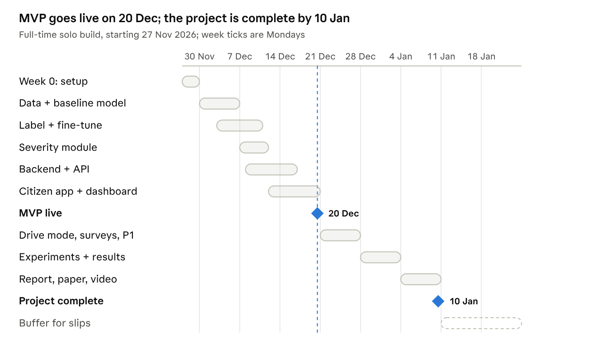

# RoadSense: Implementation Plan

Nov 27, 2026 · @Ninad Pandith M N

The step-by-step build order for RoadSense, task by task, with what "done" means for each. It follows Doc, Doc, Doc, Doc and Doc.

## Plan at a glance

Starting today and working full time: MVP live on 20 Dec 2026, feature complete on 3 Jan, everything finished by 10 Jan 2027, with two buffer weeks after.

Build timeline · 27 Nov 2026 to 24 Jan 2027

Overlapping bars are deliberate: labelling and Kaggle training run in the background while you write backend code. Christmas and New Year fall in weeks 4–5; if you take days off, use the buffer.

## How to work each day

Working full time, the PRD's 10-week plan compresses to 6 weeks plus 2 buffer weeks: start today, MVP live on 20 Dec 2026, project complete by 10 Jan 2027.

**Daily loop (about 8 hours)**

1.  **Plan (15 min):** pick today's tasks from this doc; open the related section of the PRD, App Flow or Backend Schema.

2.  **Build (3 h):** one task per AI coding session. Start each session with: *"Read CLAUDE.md and docs/. Today's task: \[task ID and text\]. Done when: \[criteria\]."*

3.  **Test (1 h):** run the tests, try it by hand on the laptop and on your phone.

4.  **Commit (15 min):** one commit per finished task, message like B3: merge reports within 5 m.

5.  **Build again (2.5 h):** next task, or background work (labelling, training runs on Kaggle).

6.  **Learn (1 h):** ask the AI to explain today's code; write 5 viva questions and answers in docs/viva-notes.md.

**Rules**

- Never start a task whose dependency isn't done; the IDs show the order.

- Kaggle training runs in the background; label data or write code while it trains.

- If a task takes more than twice its estimate, cut scope (see the P0/P1 labels in the PRD) rather than slip the MVP date.

- Sundays: half day. Review the week, update this plan, rest.

## Week 0 (27–29 Nov): accounts and setup

Everything here is free; finishing it this weekend means Monday starts with real work, not sign-ups.

**Accounts**

- [ ] GitHub account + apply for the GitHub Student Developer Pack (verification can take a few days, so do it first)

- [ ] Azure for Students activated through the pack (backend hosting)

- [ ] Supabase project created (region: Mumbai / ap-south-1), PostGIS enabled

- [ ] Kaggle account, phone-verified (needed for GPU)

- [ ] Hugging Face account + empty model repo roadsense-models

- [ ] Roboflow account + project roadsense with the 4 classes

- [ ] Vercel account linked to GitHub

- [ ] Sentry account (free)

**Laptop (Dell Inspiron 15)**

- [ ] WSL2 + Ubuntu installed

- [ ] VS Code + WSL extension; Claude Code or Cursor

- [ ] Git, Node.js LTS, pnpm, uv (Python 3.12), Supabase CLI, Azure CLI

- [ ] Phone GPS logger app that exports GPX

**Repo**

- [ ] Create public repo roadsense with the folder structure from the Tech Stack doc

- [ ] Copy all six docs into docs/ as Markdown (PRD, App Flow, Tech Stack, Content Guidelines, Backend Schema, this plan)

- [ ] Write CLAUDE.md: stack, folder layout, "follow docs/", and the content rules block from the Content Guidelines

- [ ] Choose your pilot route (10–15 km you ride often) and draw pilot_area.geojson on geojson.io

**Done when:** you can run pnpm dev and uv run uvicorn (empty apps) and every account above logs in.

## Phase 1 (30 Nov – 20 Dec): build the MVP

Three weeks to a public URL where anyone can report a pothole and an engineer can see it ranked; every task here is P0.

IDs: **M** = machine learning, **B** = backend, **F** = frontend, **D** = deploy and ops.

### Week 1 (30 Nov – 6 Dec): data and first model

| ID  | Task                                                                     | Needs  | Done when                                                   |
|-----|--------------------------------------------------------------------------|--------|-------------------------------------------------------------|
| M1  | Record the pilot route: 2 daylight rides + 1 evening ride, with GPX      | —      | 3 videos + 3 GPX files in Drive                             |
| M2  | Kaggle notebook: download RDD2022, convert to YOLO format, 4 classes     | —      | Class counts printed; train/val/test split saved            |
| M3  | Train baseline YOLO small on RDD2022 (India first, then all)             | M2     | mAP@0.5 and per-class metrics saved to ml/results/baseline/ |
| M4  | Export small + nano to ONNX; upload to Hugging Face Hub                  | M3     | ml/scripts/predict.py image.jpg prints boxes on your laptop |
| M5  | Extract 1 frame/s from M1 videos, remove blurry and duplicate frames     | M1     | 600–900 candidate frames in Roboflow                        |
| B1  | Alembic migrations 0001–0004 from the Backend Schema; seed settings v1   | Week 0 | Tables, views and RLS visible in Supabase                   |
| B2  | FastAPI skeleton: config, DB session, /health, error shape, pytest setup | Week 0 | /health returns ok; CI runs on push                         |
| D1  | GitHub Actions CI: Ruff, pytest, ESLint, build                           | B2     | Green check on every push                                   |

### Week 2 (7–13 Dec): severity and backend core

| ID  | Task                                                                                          | Needs      | Done when                                                                 |
|-----|-----------------------------------------------------------------------------------------------|------------|---------------------------------------------------------------------------|
| M6  | Label 500 local frames (Roboflow auto-label with M4, then fix by hand)                        | M4, M5     | 500 labelled frames, split by route segment                               |
| M7  | Fine-tune on RDD2022 + local data; compare on the local test set (E2)                         | M6         | Local-test mAP before vs after saved; new ONNX on HF Hub                  |
| M8  | Severity module services/severity.py: A, D (Depth Anything V2 Small ONNX), T, P → S and label | M4         | Unit tests pass; 10 sample images give sensible labels                    |
| M9  | Hand-label severity of 200 potholes (before looking at scores)                                | M5         | CSV with 200 labels in ml/data/severity_labels.csv                        |
| B3  | services/detect.py: load ONNX from HF Hub, run on an image, map classes                       | M4, B2     | Test image returns expected boxes in \< 1 s on laptop                     |
| B4  | services/privacy.py: blur faces and plates in memory                                          | B2         | Test photo with a face comes out blurred                                  |
| B5  | POST /reports: validate, rate limit, blur, store, detect, score, save, return ReportResult    | B3, B4, M8 | Postman/HTTPie upload returns a full result; rows in DB; image in storage |

### Week 3 (14–20 Dec): merge, priority, app, launch

| ID  | Task                                                                                           | Needs      | Done when                                                                          |
|-----|------------------------------------------------------------------------------------------------|------------|------------------------------------------------------------------------------------|
| B6  | Merge query + re-open rule + auto-verify (Backend Schema query 1)                              | B5         | Two uploads 3 m apart give one defect with report_count = 2                        |
| B7  | Enrichment: ward, nearest school/hospital, OSM road class; seed wards + sensitive places       | B6         | New defect has ward, road class and near_sensitive filled                          |
| B8  | Priority calculation + priority_terms + POST /admin/recalculate                                | B7         | Ranked list matches a hand calculation for 5 defects                               |
| B9  | GET /track/{code}, GET /defects, GET /defects/{id}, PATCH status, CSV export, auth + demo role | B8         | API tests cover every endpoint and the allowed status changes                      |
| F1  | React app shell: routing, Tailwind + shadcn/ui, i18next with en.json, API client               | Week 0     | All 15 routes render placeholder pages                                             |
| F2  | Citizen flow P1–P5: home, capture, review with map pin, result card, tracking                  | F1, B5, B9 | Full report from your phone in under 30 s, copy from the Content Guidelines        |
| F3  | Admin A1–A4: login, dashboard map + KPIs, repair list with filters, defect detail              | F1, B9     | You can find, open and mark a defect fixed                                         |
| D2  | Deploy: backend container to Azure Container Apps, frontend to Vercel, env vars, CORS          | B9, F2     | Public URLs work from mobile data, not just Wi-Fi                                  |
| D3  | Nightly GitHub Actions job (recalculate + keep Supabase awake)                                 | D2         | Job ran once successfully                                                          |
| —   | **Milestone: MVP live (20 Dec)**                                                               | all above  | A friend reports a pothole from their phone and you see it ranked on the dashboard |

## Phase 2 (21 Dec – 3 Jan): P1 features and experiments

Two weeks that turn a working MVP into a standout project: live Drive mode, surveys, and the numbers for the report.

### Week 4 (21–27 Dec): Drive mode, surveys, dashboard polish

| ID  | Task                                                                                                          | Needs  | Done when                                                    |
|-----|---------------------------------------------------------------------------------------------------------------|--------|--------------------------------------------------------------|
| F4  | Drive mode P6: ONNX Runtime Web with YOLO nano, camera stream, boxes, GPS, wake lock, offline queue           | M7, D2 | 10 km test ride logs detections that appear on the dashboard |
| B10 | Surveys: POST /surveys, worker loop, frame sampling, GPX matching, job states                                 | B9     | A 5-minute video becomes defects with correct locations      |
| F5  | Surveys screen A5 with progress and result card                                                               | B10    | Upload → progress → *View on map* works                      |
| F6  | Dashboard P1 items: heatmap, clustering, realtime updates, bulk status, PDF export, analytics A6, settings A7 | F3     | All A-screens match the App Flow                             |
| F7  | Public map P7 and offline outbox for citizen reports (PWA install)                                            | F2     | App installs on Android; a report made offline sends later   |
| B11 | Needs-review flow and *Not a defect* → rejected; settings changes recalculate priorities                      | B9     | Status rules from the Backend Schema all enforced            |

### Week 5 (28 Dec – 3 Jan): experiments and results page

| ID  | Task                                                                               | Needs     | Done when                                                             |
|-----|------------------------------------------------------------------------------------|-----------|-----------------------------------------------------------------------|
| M10 | E1: compare nano / small / medium (and YOLOv8s)                                    | M7        | Table of mAP, FPS and size in ml/results/                             |
| M11 | E3 + E4: severity vs hand labels; tune weights; ablation without each factor       | M8, M9    | Accuracy, kappa, confusion matrix; tuned weights saved as settings v2 |
| M12 | E5: ride the route twice; measure merge accuracy                                   | B6, F4    | Duplicates before vs after DBSCAN counted                             |
| M13 | E6: latency and FPS on laptop, server and two phones                               | D2, F4    | Timing table saved                                                    |
| M14 | Failure analysis: 15 examples incl. speed breakers, shadows, water-filled potholes | M7        | Annotated image grid for report and results page                      |
| F8  | Results page P8 with all tables, charts and sample outputs                         | M10–M14   | Page live and linked from Home                                        |
| D4  | Sentry on both apps; accessibility pass (contrast, labels, alt text)               | F6        | No console errors; Lighthouse accessibility ≥ 90                      |
| —   | **Milestone: feature complete (3 Jan)**                                            | all above | Every P0 and P1 requirement in the PRD is ticked                      |

## Phase 3 (4 – 10 Jan): write-up and launch

The last week packages the work so examiners and recruiters see it at its best; no new features after 3 Jan.

| ID  | Task                                                                                   | Needs     | Done when                                            |
|-----|----------------------------------------------------------------------------------------|-----------|------------------------------------------------------|
| W1  | README: demo link, demo GIF, architecture diagram, results table, setup steps, licence | F8        | A stranger can run it locally from the README alone  |
| W2  | Publish the local dataset (blurred) and models on Hugging Face with model cards        | M7        | Public links in the README                           |
| W3  | Project report: all chapters, using the PRD and experiment results                     | M10–M14   | Draft reviewed by your guide                         |
| W4  | Conference paper draft (IEEE template, 6 pages)                                        | W3        | Abstract, method, results, comparison table complete |
| W5  | 3-minute demo video: problem → citizen report → Drive mode → dashboard → results       | F8        | Uploaded to YouTube (unlisted) and linked            |
| W6  | Viva deck and viva notes final pass                                                    | W3        | 20 questions answered in docs/viva-notes.md          |
| W7  | LinkedIn post with the video and live link                                             | W5        | Posted                                               |
| —   | **Milestone: project complete (10 Jan)**                                               | all above | Everything in the Definition of done below is ticked |

**Buffer (11–24 Jan):** two weeks for slips, guide feedback and paper revisions. If you finish early, use it for P2 items (Hindi UI, repair cost estimate) or to submit the paper.

## Testing and quality gates

A task is not done until its tests pass in CI; these gates stop AI-written code from quietly breaking earlier work.

| Level      | What                                                                                  | Tool                                  | Gate                                            |
|------------|---------------------------------------------------------------------------------------|---------------------------------------|-------------------------------------------------|
| Unit       | Severity formula, priority formula, class mapping, tracking codes, status transitions | pytest                                | Every service file has tests; run on every push |
| API        | Each endpoint: success, validation error, auth, demo role blocked, rate limit         | pytest + httpx, test Supabase project | All pass before merge to main                   |
| Spatial    | Merge within 5 m, not at 6 m; re-open within 30 days; ward lookup                     | pytest with fixed coordinates         | Must pass; these are the core novelty           |
| Model      | Fixed set of 20 test images with expected classes                                     | pytest (slow mark)                    | No class flips after a model update             |
| Frontend   | Components and copy keys                                                              | Vitest + React Testing Library        | Runs on every push                              |
| End to end | Report → merge → dashboard → status → tracking page                                   | Playwright (2–3 scripts)              | Run before each deploy                          |
| Manual     | Phone in sunlight, slow 3G, offline, camera denied                                    | Your Android phone                    | Checklist before each milestone                 |

**Before every merge to main:** CI green · tested on phone · no hard-coded strings · viva notes updated.

## Definition of done and demo-day checklist

The project is done when every box below is ticked; the demo-day list is what you run through the morning of the viva.

**Definition of done**

- [ ] All P0 and P1 requirements from the PRD work on the live URL

- [ ] Pothole mAP@0.5 and severity agreement reported honestly, with test set sizes

- [ ] Experiments E1–E6 complete with tables in the report and on the results page

- [ ] README, demo video, models and dataset public

- [ ] Report and paper drafts approved by your guide

- [ ] Viva notes cover every module

**Demo-day checklist**

- [ ] Open the app 10 minutes early (wakes the backend and database)

- [ ] Log in to the demo account on the laptop; Drive mode tested on the phone that morning

- [ ] 30+ real defects on the map from your own rides

- [ ] Mobile hotspot ready in case college Wi-Fi blocks anything

- [ ] Backup: demo video downloaded offline

- [ ] Results page open in a tab

- [ ] One sentence ready: *"RoadSense doesn't just detect potholes; it tells a city which one to fix first, and why."*
