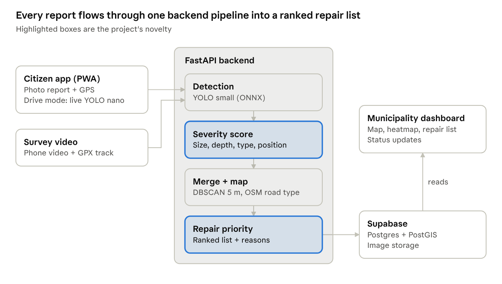
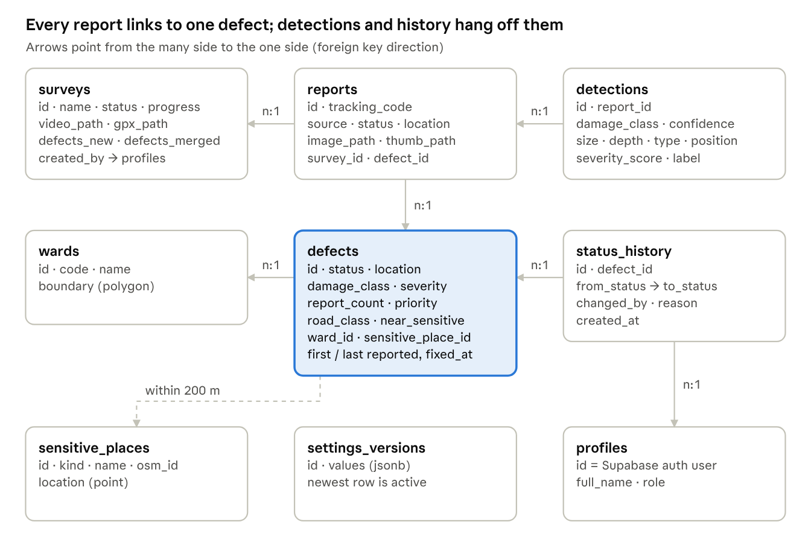
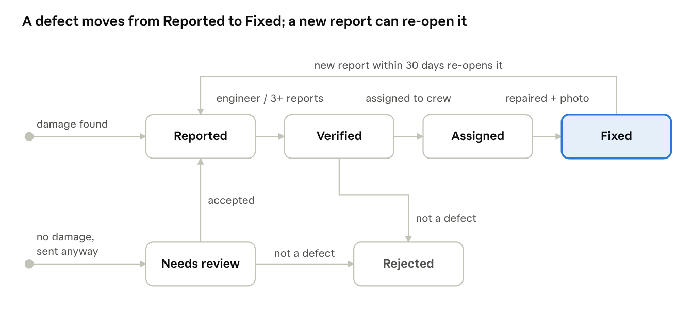
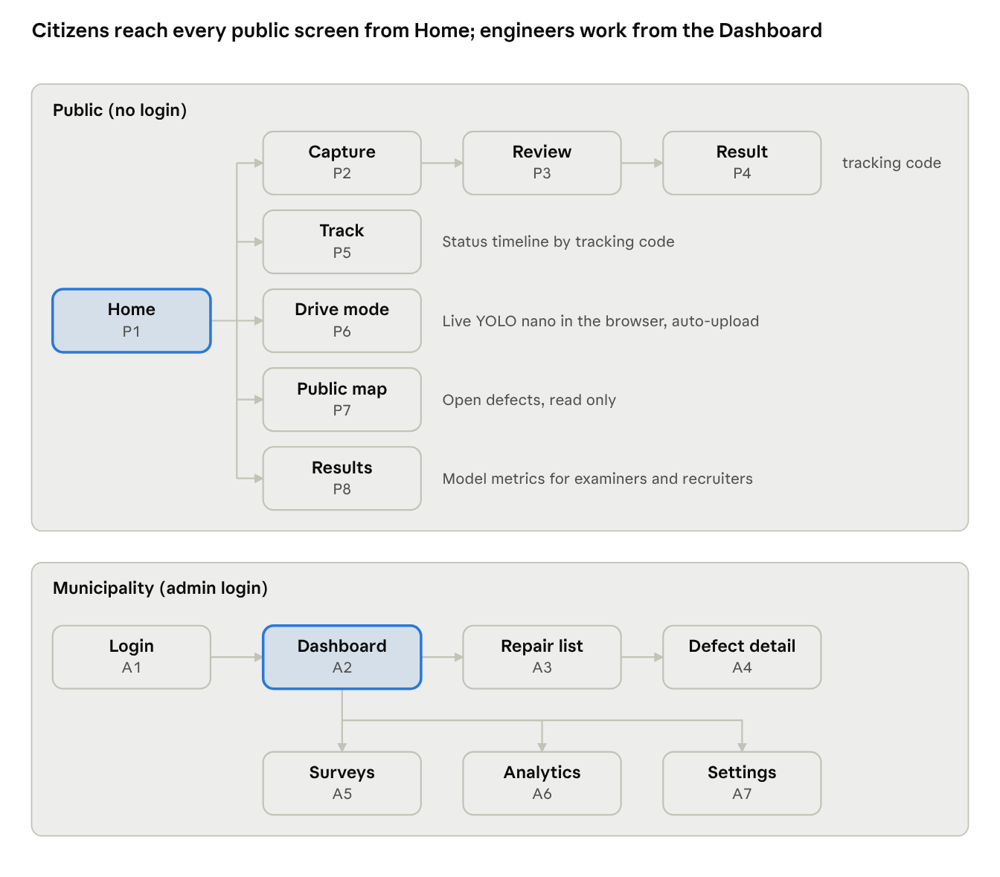

# System design

## Architecture

{#fig:arch width=95%}

RoadSense has three runtime parts:

- **Frontend**: one React progressive web app with the citizen screens, Drive mode and the
  engineer dashboard, hosted on Vercel. Drive mode runs a YOLO nano model in the browser.
- **Backend**: one FastAPI service that runs the models and the business logic, in a container
  on Azure Container Apps, scaling to zero when idle.
- **Data**: Supabase Postgres with PostGIS for spatial queries, Supabase Storage for blurred
  images, Supabase Auth for engineers and Supabase Realtime for live dashboard updates.

Models are trained on Kaggle, exported to ONNX and stored on the Hugging Face Hub, from where the
backend downloads them. Using ONNX everywhere means one model file runs on the server CPU, the
laptop and the phone browser.

## Processing sequence

Every photo, Drive-mode frame and survey frame goes through the same steps:

1. **Receive** the image, location, time and source. Check the file type from its header, the
   size (≤ 50 MB), the pilot area and the rate limit.
2. **Blur** faces and number plates in memory. The unblurred image is never stored.
3. **Check quality**: reject photos that are too dark or too blurry.
4. **Detect** damage with YOLO (confidence ≥ 0.35). No detection: the report is saved as
   *no damage* and the citizen may send it anyway for an engineer to review.
5. **Score** each detection for severity (Section 4.4) and save it with the model version.
6. **Merge** with an open defect within 5 m, or create a new defect (Section 4.6).
7. **Enrich** a new defect with its ward, the nearest school or hospital within 200 m and its
   road type from OpenStreetMap.
8. **Prioritise** the defect (Section 4.5).
9. **Respond** with the damage type, severity and its breakdown, whether the report was merged,
   and the tracking code. The dashboard updates through Supabase Realtime.

## Data model

{#fig:er width=95%}

The central table is `defects`: many `reports` (one per photo or frame) merge into one defect,
each report has zero or more `detections`, and every status change is written to
`status_history`. `surveys` holds video jobs, `wards` and `sensitive_places` hold city data,
`profiles` links engineers to Supabase Auth, and `settings_versions` stores every version of the
weights and thresholds, the newest being active. Locations are `geography(Point, 4326)`, so
distances are in metres, with GiST spatial indexes. Row level security lets the public read only
a view of open defects without personal data; all writes go through the API.

## Severity score

For each detection the severity is

$$S = w_A A + w_D D + w_T T + w_P P, \qquad (w_A, w_D, w_T, w_P) = (0.35, 0.35, 0.20, 0.10)$$

with every factor normalised to 0–1:

- **Size A**: the part of the box inside the road region (the lower 55% of the frame) divided by
  that region's area, reaching 1 when the box covers 20% of the road region.
- **Depth D**: Depth Anything V2 Small gives relative inverse depth for the whole image. The
  median inside the box is compared with the median of a ring of road around it (half a box
  width and height). The floor of a pothole is further from the camera, so its inverse depth is
  lower; the drop is divided by the image's depth range (5th–95th percentile) and reaches 1 at
  8% of that range.
- **Type T**: pothole 1.0, alligator crack 0.7, crack across the road 0.5, crack along the road 0.4.
- **Position P**: 1.0 within 20% of the frame's centre line (the wheel path), falling linearly to
  0.3 at the edge.

Labels: Minor below 0.40, Moderate 0.40–0.69, Dangerous 0.70 and above. A defect keeps the
highest severity of all its reports. If the depth model is unavailable, D is skipped and the other
weights are rescaled to sum to 1, so scores stay comparable. The citizen sees the result as a
sentence built from the strongest factors, for example "Dangerous because it is large, looks deep
and in the wheel path".

## Repair priority

$$\text{Priority} = S \times R \times \big(1 + 0.1\min(n, 10)\big) \times \big(1 + 0.02\min(t, 30)\big) \times B$$

| Term | Meaning | Values |
|------|---------|--------|
| S | Severity of the defect | 0–1 |
| R | Road importance from OSM | trunk/primary 1.0, secondary 0.8, tertiary 0.6, residential 0.4, unknown 0.5 |
| n | Number of reports | capped at 10 (at most ×2) |
| t | Days since first reported | capped at 30 (at most ×1.6) |
| B | School or hospital within 200 m | 1.3, else 1.0 |

The caps stop a much-reported or old defect from outranking a dangerous new pothole on a main
road. Every term is stored with the defect and shown on the detail screen together with a
plain-words reason such as "Dangerous · main road · near school · 6 reports · 12 days open".
Priorities are recalculated after every merge, after every settings change and nightly, because
the age term grows each day.

## Duplicate merging

A new report is matched to the nearest open defect within the merge radius (5 m by default):

```sql
select id from defects
where ST_DWithin(location, :point, :radius_m)
  and (status in ('needs_review','reported','verified','assigned')
       or (status = 'fixed' and fixed_at > now() - interval '30 days'))
order by ST_Distance(location, :point)
limit 1 for update;
```

This is the online form of DBSCAN with ε = 5 m and one point per cluster: reports arrive one at a
time, so each is attached to the nearest existing cluster or starts a new one. On a match the
report count increases, the defect keeps the higher severity and moves to the average position of
its reports. A report on a defect fixed in the last 30 days re-opens it. At 3 reports a defect is
verified automatically. Transaction-level advisory locks on the map grid cells the 5 m circle
touches stop two simultaneous reports of the same pothole from creating two defects.

## Defect status lifecycle

{#fig:status width=85%}

Allowed changes: needs review → reported or rejected; reported → verified, assigned or rejected;
verified → assigned or rejected; assigned → fixed or rejected; fixed → reported only when a new
report re-opens it. Any other change is refused.

## User interface

The app has 15 screens: 8 public (home, capture, review, result, track, Drive mode, public map,
results) and 7 for engineers (login, dashboard, repair list, defect detail, surveys, analytics,
settings). All text follows a written content guide: plain words, Indian English spelling,
severity always shown as word + colour + icon, and errors that say what happened and what to do.

{#fig:appmap width=95%}
