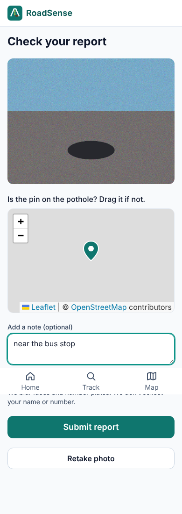
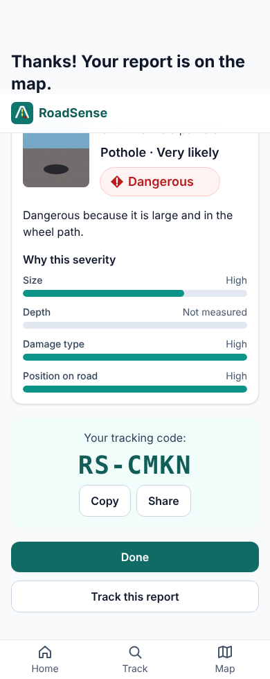
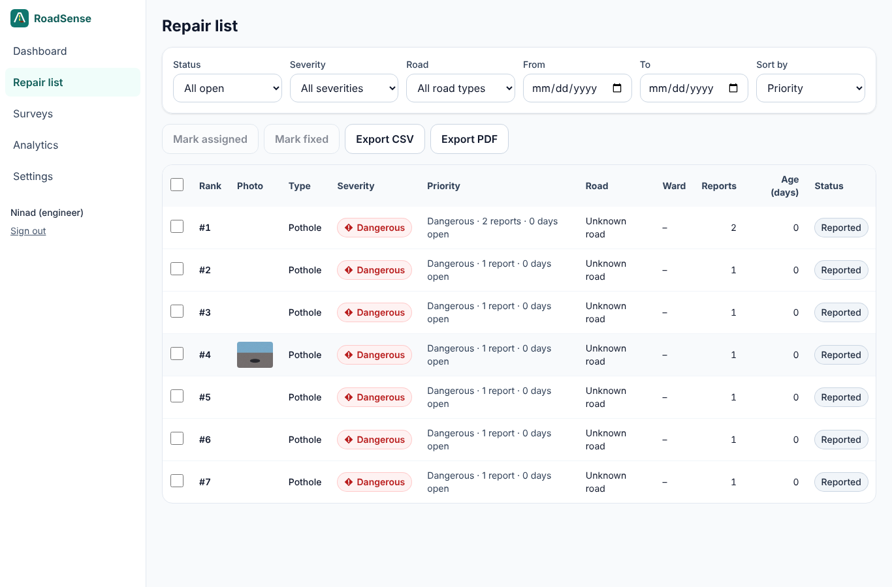
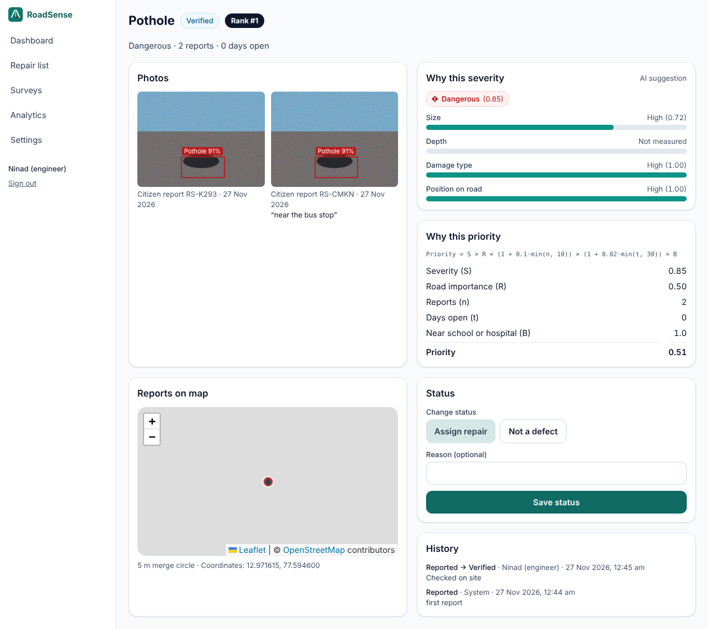
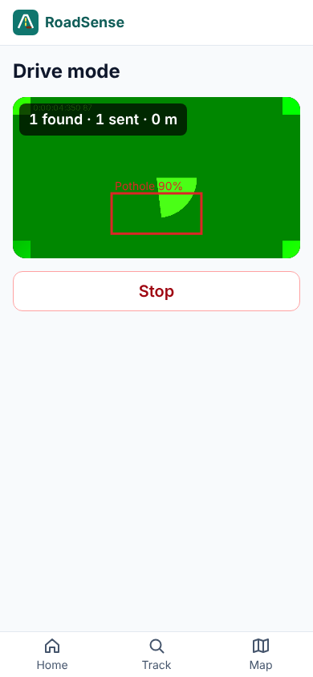

# Implementation

## Technology choices

| Layer | Choice | Reason |
|-------|--------|--------|
| Frontend | React, TypeScript, Vite, Tailwind CSS, TanStack Query, React Leaflet, Recharts, i18next | One typed app for all users; strong tooling |
| In-browser AI | ONNX Runtime Web (WebGPU, WASM fallback) | Live detection on the phone, no server cost |
| Backend | Python 3.12, FastAPI, Pydantic, SQLAlchemy, GeoAlchemy2, Alembic | Same language as the ML code; typed endpoints with automatic API docs |
| Detection | Ultralytics YOLO11, exported to ONNX, ONNX Runtime on CPU | Fast, accurate, one model format everywhere |
| Depth | Depth Anything V2 Small (ONNX) | Robust relative depth from one photo, Apache-2.0 |
| Data | Supabase (Postgres + PostGIS, Storage, Auth, Realtime) | Spatial queries plus storage, auth and realtime on one free tier |
| Hosting | Vercel (frontend), Azure Container Apps (backend) | Free, public URLs; scale to zero |
| CI/CD | GitHub Actions | Tests and lint on every push; deploy on merge |

## Backend

The backend is organised into `api` (routes), `core` (configuration, database, authentication,
errors), `services` (detection, depth, severity, privacy, merging, geo lookups, priority,
surveys), `models` (database tables) and `schemas` (request and response models). Every error
uses one shape, `{"error": {"code", "message"}}`, so the frontend can show the matching message
from the content guide.

**Detection.** Images are letterboxed to 640×640 as Ultralytics does; the ONNX output (box centre,
size and a score per class for 8,400 candidates) is decoded, filtered at confidence 0.35 and
reduced with class-aware non-maximum suppression at IoU 0.5. The same decoding is ported to
TypeScript for Drive mode, and both are unit-tested against the same synthetic outputs.

**Privacy.** Faces (frontal and profile) and number plates are found with OpenCV's Haar cascades
and each region is pixelated and blurred in memory before anything is written. Stored images are
re-encoded as JPEG without EXIF; GPS and time live only in the database row.

**Settings.** Weights, thresholds and radii are read from the newest `settings_versions` row. An
engineer can change them on the Settings screen; each save is a new version (an audit trail) and
recalculates all open priorities.

**Authentication.** Engineers sign in with Supabase Auth. FastAPI verifies the JWT and reads the
user's role; every write endpoint refuses the read-only demo role, so examiners can explore safely.

**Rate limits.** Citizen photos are limited to 10 per hour per network and Drive-mode frames to 120
per hour, counted separately. The network address is stored only as a salted SHA-256 hash and
cleared after 30 days.

## Survey processing

An engineer uploads a ride video (MP4, ≤ 50 MB) and its GPX track. A worker thread claims queued
jobs with `SELECT … FOR UPDATE SKIP LOCKED` and moves them through the states queued, extracting,
detecting, scoring, merging and done (or failed with a reason). The video's start time is read
from the MP4 movie header (or taken from the GPS track), frames are sampled at 4 per second, and
each frame's position is interpolated from the track at the frame's time. The same pothole seen in
consecutive frames (within 2 s and 5 m) is kept once, using the most confident frame, so one ride
does not inflate the report count. Only frames with damage are stored; the uploaded video and
track are deleted when the job ends.

## Frontend

The citizen flow takes three taps: *Report a pothole*, take or choose a photo, *Submit report*.
GPS comes from the browser, or from the photo's EXIF for gallery photos, and the pin can be dragged.
Photos are resized to 1,280 px on the phone before upload. The result card shows the damage type
with a confidence word, the severity badge, the reason and four factor bars, and a tracking code
that is also saved on the phone.

{width=40%} {width=40%}

Reports made without a connection wait in an IndexedDB outbox and are sent when the phone comes
back online; each carries a client-generated ID, so a retry never creates a second report. A
service worker makes the app installable and caches the app shell, the Drive-mode model and map
tiles.

The engineer dashboard shows key numbers, a clustered severity map with a heatmap option and the
top ten defects to fix. The repair list is filtered and sorted through the URL and supports bulk
status changes, CSV export and a PDF work order. The defect detail screen shows every photo with
its boxes, the severity factors, each priority term, a map of the reports with the merge circle,
and the status history.

{width=95%}

{width=95%}

## Drive mode

Drive mode turns a phone on the handlebar or dashboard into a road surveyor. After a one-time
safety screen it downloads the YOLO nano model (cached afterwards), opens the rear camera, keeps the
screen awake with the Wake Lock API and tracks GPS. The model runs about 5 times a second; boxes are
drawn over the live view. Detections above 0.5 confidence are grouped: the most confident frame of
each run of detections (frames within 2 s) is queued once and uploaded in the background through
the same outbox. If the phone manages fewer than 2 frames a second, Drive mode offers to send a
photo every 2 seconds for the server to check instead. The summary shows the potholes found, the
distance, a route map and the measured detection speed.

{width=35%}

## Deployment and operations

GitHub Actions runs linting, backend tests against a real PostGIS service, frontend unit tests,
the build, and end-to-end tests with accessibility checks on every push. On a merge to the main
branch it builds the backend image, runs the database migrations and updates the container app;
Vercel deploys the frontend. A nightly job recalculates priorities, clears old address hashes and
keeps the free database from pausing. Errors from both apps go to Sentry with personal data
removed.
