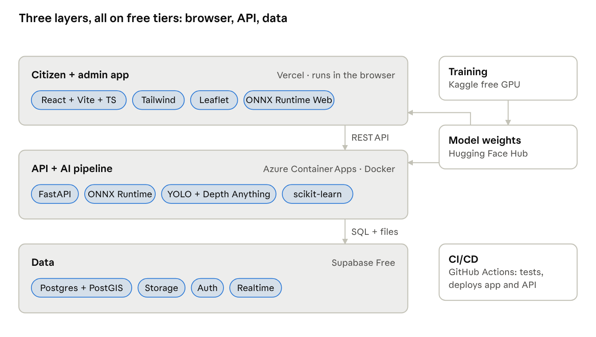

# RoadSense: Tech Stack

Nov 26, 2026 · @Ninad Pandith M N

Every technology RoadSense uses, why it was chosen, and how the pieces connect. Requirements come from Doc; screens come from Doc.

## Stack at a glance

RoadSense is a React PWA on Vercel, a FastAPI + ONNX backend on Azure Container Apps, and Supabase for data, with models trained on Kaggle; all of it runs on free tiers.



Tech stack · 3 runtime layers + training, weights, CI/CD

The browser also talks to Supabase directly for admin login and live dashboard updates. Model weights flow from Kaggle to the Hugging Face Hub, then into both the backend (YOLO small, Depth Anything) and the browser (YOLO nano).

## Frontend

One React + TypeScript app built with Vite serves both the citizen PWA and the admin dashboard; it is the most common stack AI coding tools write well.

| Need          | Choice                                                              | Notes                                                                   |
|---------------|---------------------------------------------------------------------|-------------------------------------------------------------------------|
| Framework     | React + TypeScript, built with Vite                                 | Fast dev server; TypeScript catches AI-written mistakes early           |
| Routing       | React Router                                                        | Routes as in the App Flow screen inventory (/report, /admin/repairs, …) |
| Styling       | Tailwind CSS + shadcn/ui components                                 | Clean, consistent UI without designing from scratch                     |
| Server data   | TanStack Query                                                      | Caching, loading and error states for every API call                    |
| Maps          | Leaflet via react-leaflet, OpenStreetMap tiles                      | Free; plugins: leaflet.heat (heatmap), leaflet.markercluster            |
| Charts        | Recharts                                                            | Analytics screen (A6)                                                   |
| PWA           | vite-plugin-pwa                                                     | Installable app, offline outbox for reports                             |
| Camera + GPS  | Browser MediaDevices and Geolocation APIs; exifr for photo EXIF GPS | No native app needed                                                    |
| Screen awake  | Wake Lock API                                                       | Drive mode                                                              |
| In-browser AI | ONNX Runtime Web (WebGPU with WASM fallback)                        | Runs YOLO nano live in Drive mode                                       |
| Realtime      | Supabase JS client (Realtime channel)                               | Dashboard updates when new reports arrive                               |
| PDF export    | jsPDF + jspdf-autotable                                             | Work-order PDF from the repair list                                     |

## Backend and API

A single Python FastAPI service runs the models and the business logic, so the ML code and the API share one language and one container.

| Need            | Choice                                                                              | Notes                                                       |
|-----------------|-------------------------------------------------------------------------------------|-------------------------------------------------------------|
| Language        | Python 3.11 or 3.12                                                                 | Best support across ONNX Runtime, PyTorch and geo libraries |
| Framework       | FastAPI + Uvicorn                                                                   | Async, automatic OpenAPI docs at /docs (great for the viva) |
| Validation      | Pydantic v2                                                                         | Request and response models for every endpoint              |
| Database access | SQLAlchemy 2 + GeoAlchemy2, Alembic migrations                                      | PostGIS types and spatial queries from Python               |
| Background jobs | FastAPI BackgroundTasks for photos; a jobs table polled by a worker loop for videos | No Redis or Celery needed at this scale                     |
| Video handling  | OpenCV (frame sampling), gpxpy (GPX parsing)                                        | Matches frames to GPS by timestamp                          |
| Image handling  | Pillow, OpenCV; piexif for EXIF                                                     | Resize, blur, read GPS                                      |
| Rate limiting   | slowapi                                                                             | 10 reports per IP per hour                                  |
| Scheduled jobs  | GitHub Actions cron calling a protected endpoint                                    | Nightly priority recalculation; keeps the database awake    |
| Testing         | pytest + httpx                                                                      | Every module ships with tests                               |
| Code quality    | Ruff (lint + format)                                                                | One tool, fast                                              |

**Main endpoints** (from the App Flow): POST /reports, GET /track/{code}, POST /surveys, GET /surveys/{id}, GET /defects, GET /defects/{id}, PATCH /defects/{id}/status, GET /repair-list.csv, GET /stats, POST /admin/recalculate.

## Machine learning

Train in PyTorch on Kaggle's free GPU, then export every model to ONNX so the same file runs on the server CPU, on your laptop and in the phone browser.

| Need                | Choice                                                                                  | Notes                                                       |
|---------------------|-----------------------------------------------------------------------------------------|-------------------------------------------------------------|
| Detector training   | Ultralytics YOLO (YOLO11, or the newest version Ultralytics supports when you start)    | Small model for the server, nano for the browser            |
| Training compute    | Kaggle Notebooks (free GPU, weekly quota); Google Colab as backup                       | Your laptop has no NVIDIA GPU, so all training happens here |
| Dataset prep        | Roboflow (labelling + export in YOLO format)                                            | Use its auto-label with your first model to speed up        |
| Experiment tracking | Ultralytics built-in plots + a results/ folder in Git; optional Weights & Biases (free) | Keeps every run comparable for the report                   |
| Export format       | ONNX (opset 12+)                                                                        | One model file for every runtime                            |
| Server inference    | ONNX Runtime (CPU)                                                                      | No GPU needed for one photo at a time                       |
| Browser inference   | ONNX Runtime Web (WebGPU, WASM fallback)                                                | Drive mode                                                  |
| Depth               | Depth Anything V2 Small, exported to ONNX                                               | Relative depth for the severity score                       |
| Privacy blur        | A small face/plate detector (YOLO nano face + plate weights) or OpenCV DNN face model   | Runs before saving any image                                |
| Clustering          | scikit-learn DBSCAN (haversine)                                                         | Duplicate merging                                           |
| Model storage       | Hugging Face Hub model repo (free)                                                      | Versioned weights the backend downloads on start            |

**Licence note:** Ultralytics YOLO is AGPL-3.0. Keep your repo public and open source (good for a resume anyway), and say so in the README.

## Database, storage and geo

Supabase gives one free project with Postgres + PostGIS, file storage, auth and realtime, which covers four needs with one service.

| Need              | Choice                                                                          | Notes                                                                   |
|-------------------|---------------------------------------------------------------------------------|-------------------------------------------------------------------------|
| Database          | Supabase Postgres with the PostGIS extension                                    | Tables from the PRD: reports, detections, defects, status_history, jobs |
| Spatial queries   | PostGIS ST_DWithin, ST_Distance, GiST index on defects.location                 | 5 m merge check and map bounding-box queries                            |
| Images and videos | Supabase Storage, buckets reports (public, blurred) and surveys (private)       | Store a resized 1280 px image plus a 320 px thumbnail                   |
| Realtime          | Supabase Realtime on defects                                                    | Live dashboard updates                                                  |
| Road data         | OpenStreetMap via the Overpass API, queried with OSMnx                          | Road type, schools, hospitals around the pilot area                     |
| Ward boundaries   | Your city corporation's open data or OSM admin boundaries                       | Download once as GeoJSON, load into a wards table                       |
| Map tiles         | OpenStreetMap tiles (respect the tile usage policy) or free-tier CARTO basemaps | Free for low traffic                                                    |

To save free storage, keep only blurred, resized images. Delete survey videos after processing; keep only the frames with detections.

## Auth, security and privacy

Only engineers log in; citizens stay anonymous, and every image is blurred before it is stored.

| Area            | Choice                                                                                                                                              |
|-----------------|-----------------------------------------------------------------------------------------------------------------------------------------------------|
| Admin login     | Supabase Auth (email + password); the frontend sends the JWT, FastAPI verifies it on every /admin route                                             |
| Demo access     | A read-only demo role for examiners and recruiters                                                                                                  |
| Database access | Row Level Security on all tables; the browser reads only public views (open defects, report status); writes go through FastAPI with the service key |
| Secrets         | Environment variables only; .env in .gitignore; GitHub Actions secrets for CI                                                                       |
| Uploads         | Allow JPEG/PNG/WebP/MP4 only, max 50 MB, checked by content type and file header                                                                    |
| Abuse           | Rate limit per IP; AI check rejects non-road photos; engineers can mark *Not a defect*                                                              |
| Privacy         | Blur faces and number plates server-side before storing; strip EXIF except GPS and time; no names or phone numbers collected                        |
| Transport       | HTTPS everywhere (default on Vercel and the backend host); CORS limited to the frontend domain                                                      |

## Hosting, deployment and CI/CD

The frontend goes on Vercel and the backend container goes on Azure Container Apps using the free Azure for Students credit; this replaces Hugging Face Spaces from the PRD, which now needs a paid plan for Docker Spaces.

| Part                       | Host                                                                                                                     | Why                                                                                                                        |
|----------------------------|--------------------------------------------------------------------------------------------------------------------------|----------------------------------------------------------------------------------------------------------------------------|
| Frontend (React PWA)       | Vercel, Hobby plan                                                                                                       | Free, deploys on every push, preview URL per branch                                                                        |
| Backend (FastAPI + models) | Azure Container Apps, 1 vCPU / 2 GiB, scale to zero                                                                      | Azure for Students credit (via GitHub Student Developer Pack) with no credit card; enough memory for YOLO + Depth Anything |
| Backend fallback           | Modal (Starter plan, monthly free credits)                                                                               | Serverless Python, simple deploy, if Azure activation fails                                                                |
| Database, storage, auth    | Supabase Free                                                                                                            | See Database section                                                                                                       |
| Model weights              | Hugging Face Hub model repo                                                                                              | Free model hosting (model repos are still free; only compute Spaces need a paid plan)                                      |
| Container images           | GitHub Container Registry                                                                                                | Free for public repos                                                                                                      |
| CI                         | GitHub Actions: lint (Ruff, ESLint), tests (pytest, Vitest), build                                                       | Runs on every pull request                                                                                                 |
| CD                         | GitHub Actions builds the backend image and deploys to Azure on merge to main; Vercel deploys the frontend automatically | One push = live demo updated                                                                                               |
| Keep-alive                 | GitHub Actions cron every day: nightly recalculation + a small database query                                            | Stops the free Supabase project from pausing                                                                               |
| Monitoring                 | Sentry free tier (frontend + backend errors); Azure log stream                                                           | Catch errors before the viva                                                                                               |

**Cold starts:** scale-to-zero means the first request after idle can take 20–40 s while models load. Open the app 5 minutes before any demo.

## Development setup on your laptop

Your Dell Inspiron 15 (Intel Core i7, Intel Iris Xe graphics) is fine for building and testing everything; only model training moves to Kaggle, because Iris Xe has no NVIDIA CUDA support.

| What                      | Where it runs                | Setup                                                                                                             |
|---------------------------|------------------------------|-------------------------------------------------------------------------------------------------------------------|
| Code editing + AI coding  | Laptop                       | VS Code with Claude Code (or Cursor)                                                                              |
| Backend + local inference | Laptop, inside WSL2 (Ubuntu) | Python 3.12 via uv; ONNX Runtime CPU runs YOLO small at a few images per second, enough for testing               |
| Optional speed-up         | Laptop                       | OpenVINO execution provider for ONNX Runtime uses the Iris Xe GPU                                                 |
| Frontend                  | Laptop (Windows or WSL2)     | Node.js LTS + pnpm; pnpm dev                                                                                      |
| Database                  | Cloud                        | Use your free Supabase project directly; no local Postgres needed                                                 |
| Model training            | Kaggle Notebooks (GPU)       | Push weights to the Hugging Face Hub; pull them in the backend                                                    |
| Phone testing             | Your Android phone           | Open the Vercel preview URL, or the laptop's dev server over the same Wi-Fi with HTTPS (needed for camera access) |
| Git                       | Laptop                       | Git + GitHub CLI; commit after every working step                                                                 |

**Install list:** WSL2 + Ubuntu, VS Code, Git, Node.js LTS, pnpm, uv (Python), Claude Code or Cursor, Supabase CLI, Azure CLI.

**If the laptop has 8 GB RAM:** skip Docker Desktop and run the backend directly in WSL2; Docker builds can run in GitHub Actions instead. With 16 GB, Docker Desktop is fine.

## Repository structure and environment variables

One public GitHub monorepo holds the app, the ML code and the docs, so a recruiter sees the whole project in one place.

```text
roadsense/
├─ frontend/ React + Vite + TS PWA
│ ├─ src/pages/ one folder per screen (P1–P8, A1–A7)
│ ├─ src/components/ map, cards, tables, charts
│ ├─ src/lib/ api client, supabase client, onnx runner
│ └─ public/models/ yolo-nano.onnx (Drive mode)
├─ backend/ FastAPI service
│ ├─ app/api/ routes
│ ├─ app/core/ config, auth, db
│ ├─ app/services/ detect, severity, geo, priority, privacy, jobs
│ ├─ app/models/ SQLAlchemy tables
│ ├─ alembic/ migrations
│ ├─ tests/
│ └─ Dockerfile
├─ ml/ training + evaluation
│ ├─ notebooks/ Kaggle training, experiments E1–E6
│ ├─ scripts/ dataset prep, export to ONNX, evaluation
│ └─ results/ metrics, plots, tables for the report
├─ docs/ PRD, app flow, tech stack, viva notes
├─ .github/workflows/ ci.yml, deploy.yml, nightly.yml
├─ CLAUDE.md rules for the AI coding tool
└─ README.md demo link, GIF, architecture, results
```

| Variable             | Used by                 | Purpose                                 |
|----------------------|-------------------------|-----------------------------------------|
| SUPABASE_URL         | frontend, backend       | Project URL                             |
| SUPABASE_ANON_KEY    | frontend                | Public key for read-only views and auth |
| SUPABASE_SERVICE_KEY | backend only            | Writes; never sent to the browser       |
| DATABASE_URL         | backend                 | Postgres connection for SQLAlchemy      |
| SUPABASE_JWT_SECRET  | backend                 | Verify admin tokens                     |
| HF_MODEL_REPO        | backend                 | Where to download model weights         |
| MODEL_VERSION        | backend                 | Stored with every detection             |
| ALLOWED_ORIGINS      | backend                 | CORS: the Vercel domain                 |
| CRON_SECRET          | backend, GitHub Actions | Protects the nightly endpoint           |
| VITE_API_URL         | frontend                | Backend base URL                        |
| SENTRY_DSN           | both                    | Error tracking                          |

## Cost and free-tier limits

The project runs at ₹0 if you stay inside these limits; the ones most likely to bite are Supabase's pause after a week of inactivity and its 1 GB file storage.

| Service               | Free allowance (checked Nov 2026)                                                                                                                                                                                                                     | How RoadSense stays inside it                                                                    |
|-----------------------|-------------------------------------------------------------------------------------------------------------------------------------------------------------------------------------------------------------------------------------------------------|--------------------------------------------------------------------------------------------------|
| Supabase Free         | 500 MB database, 1 GB file storage, 5 GB egress, 2 active projects; paused after 1 week of inactivity ([pricing](https://supabase.com/docs/pricing))                                                                                                  | Store only resized, blurred images (about 150 KB each ≈ 6,000 images); daily cron keeps it awake |
| Kaggle Notebooks      | About 30 GPU hours per week, sessions up to 12 hours ([Kaggle overview](https://www.datacamp.com/tutorial/tutorial-kaggle-datasets-tutorials-kaggle-notebooks))                                                                                       | One YOLO small run on RDD2022 fits in a session; save checkpoints to output                      |
| Azure for Students    | \$100 credit via the GitHub Student Developer Pack, no card when activated through student verification ([pack](https://education.github.com/pack), [Microsoft Q&A](https://learn.microsoft.com/en-us/answers/questions/5815601/github-student-plan)) | Container Apps scales to zero when idle, so the credit lasts the project                         |
| Modal (fallback)      | Starter plan, \$0 base with monthly compute credits ([pricing](https://modal.com/pricing))                                                                                                                                                            | Only if Azure fails                                                                              |
| Hugging Face Hub      | Model repos free; Docker/Gradio Spaces now need a paid plan ([Spaces docs](https://huggingface.co/docs/hub/en/spaces-overview))                                                                                                                       | Host weights only                                                                                |
| Vercel Hobby          | Free for personal projects                                                                                                                                                                                                                            | Static PWA, tiny bandwidth                                                                       |
| GitHub                | Free public repos, Actions and Container Registry for public repos                                                                                                                                                                                    | Keep the repo public                                                                             |
| Roboflow, Sentry, W&B | Free tiers                                                                                                                                                                                                                                            | Small datasets and low error volume                                                              |

**Total: ₹0 per month.** The only possible spend is a domain name (optional; the student pack includes one free domain offer).

## Alternatives considered

Each rejected option would work, but costs more time, money or resume value for a solo build.

| Option                          | Instead of               | Why not                                                                                     |
|---------------------------------|--------------------------|---------------------------------------------------------------------------------------------|
| Streamlit                       | React PWA                | Faster to start, but no real mobile app, no Drive mode, looks like a notebook to recruiters |
| Flutter app                     | React PWA                | Needs an APK install; two codebases (app + dashboard) for one person                        |
| Next.js                         | React + Vite             | Server rendering isn't needed; Vite is simpler and deploys anywhere                         |
| Django                          | FastAPI                  | Heavier; FastAPI's typed endpoints and auto docs suit an ML API better                      |
| Firebase                        | Supabase                 | No PostGIS; spatial merge queries would be hard                                             |
| Plain PostgreSQL on a VM        | Supabase                 | You would also have to build storage, auth and realtime yourself                            |
| Hugging Face Spaces             | Azure Container Apps     | Docker Spaces now need a paid plan                                                          |
| Render / Koyeb free             | Azure Container Apps     | Free instances have too little memory for YOLO + Depth Anything                             |
| TensorFlow Lite in a native app | ONNX Runtime Web         | One model format everywhere; no app store                                                   |
| Celery + Redis                  | Jobs table + worker loop | Extra service to host for a few videos a week                                               |
| Google Maps                     | Leaflet + OSM            | Needs a billing account; OSM is free and has road-type data                                 |

## Sources

- [Supabase pricing and Free plan limits](https://supabase.com/docs/pricing)

- [Supabase: free project pausing](https://supabase.com/kb/faqs/platform/free-project-pausing)

- [Hugging Face Spaces overview (paid plan for Docker/Gradio Spaces)](https://huggingface.co/docs/hub/en/spaces-overview)

- [Modal pricing](https://modal.com/pricing)

- [GitHub Student Developer Pack](https://education.github.com/pack)

- [Microsoft Q&A: redeeming Azure student credit without a card](https://learn.microsoft.com/en-us/answers/questions/5815601/github-student-plan)

- [DataCamp: Kaggle Notebooks GPU limit](https://www.datacamp.com/tutorial/tutorial-kaggle-datasets-tutorials-kaggle-notebooks)

Free-tier limits change often; recheck each pricing page when you sign up.
